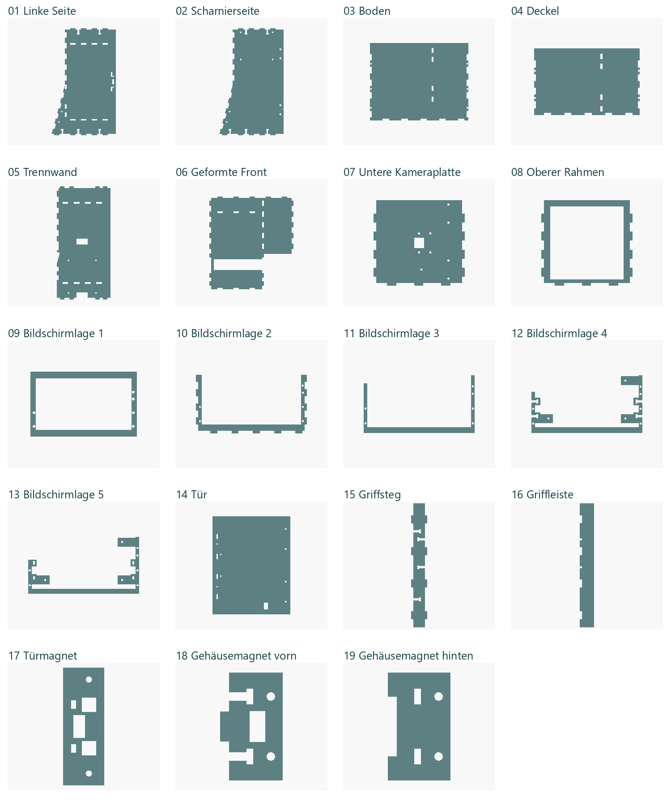
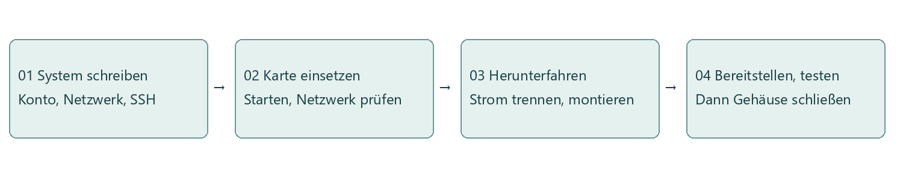
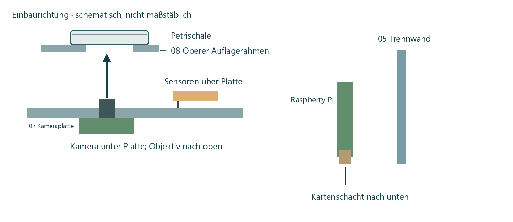
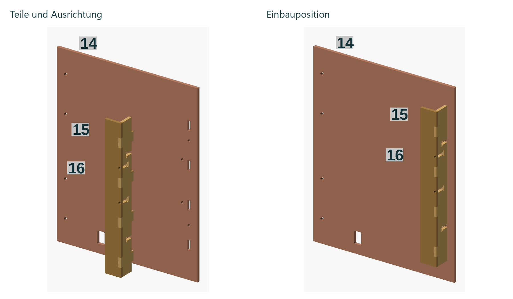
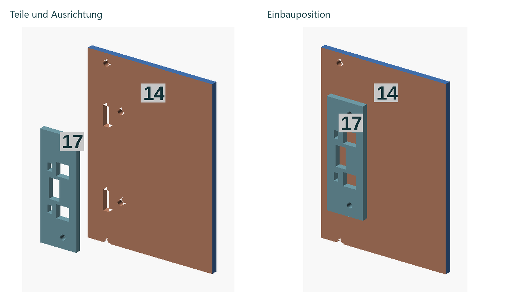
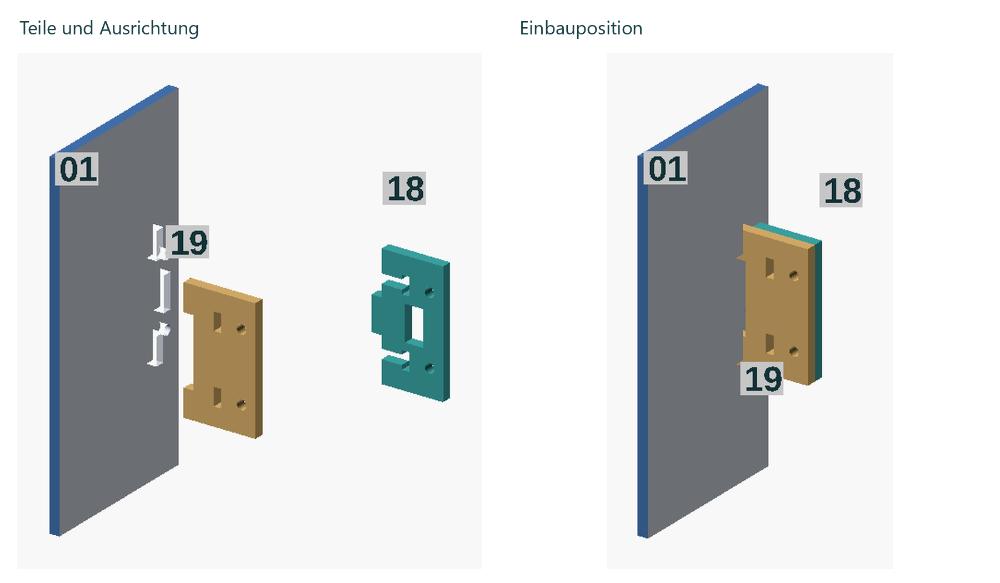
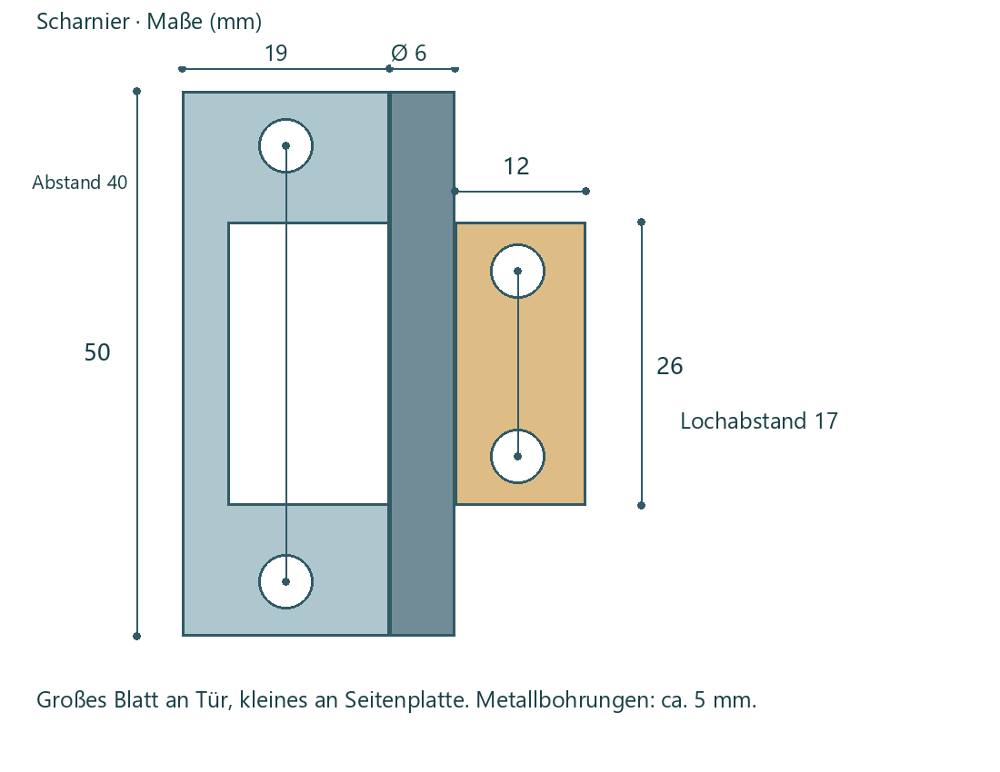
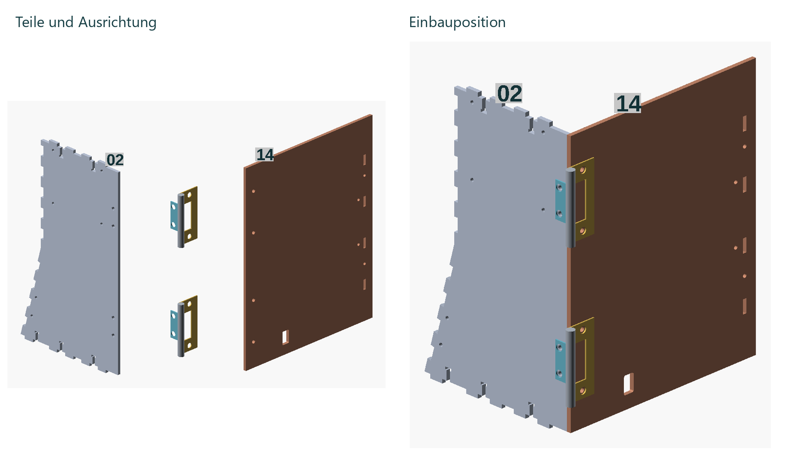

# PetriTrace – Bau- und Bedienungsanleitung

Version 1.0 · Deutsch

GitHub: J-ShuJie

Projekt: [https://github.com/J-ShuJie/PetriTrace](https://github.com/J-ShuJie/PetriTrace)

## Inhalt

- [1. Einführung](#section-1)
  - [1.1 Verwendungszweck](#section-1-1)
  - [1.2 Hardware](#section-1-2)
  - [1.3 Software](#section-1-3)
  - [1.4 Verwendung der Anleitung](#section-1-4)
- [2. Materialien](#section-2)
  - [2.1 Elektronische Komponenten](#section-2-1)
  - [2.2 Gehäuse und mechanische Teile](#section-2-2)
  - [2.3 Entwurfs- und Fertigungsdateien](#section-2-3)
- [3. System und Firmware vorbereiten](#section-3)
  - [3.1 Betriebssystem und Speicherkarte](#section-3-1)
  - [3.2 Pico programmieren](#section-3-2)
  - [3.3 Reihenfolge von Montage und Bereitstellung](#section-3-3)
- [4. Elektronik und Gehäuse montieren](#section-4)
  - [4.1 Raspberry Pi und Erweiterungsplatine](#section-4-1)
  - [4.2 Kamera und Umgebungssensoren](#section-4-2)
  - [4.3 Fünflagiger Bildschirmrahmen](#section-4-3)
  - [4.4 Rahmen und Beleuchtung](#section-4-4)
  - [4.5 Tür, Griff und Magnete](#section-4-5)
- [5. Verkabelung und Abschlussprüfung](#section-5)
- [6. Installation und Bereitstellung](#section-6)
  - [6.1 Erste Verbindung](#section-6-1)
  - [6.2 Fernzugriff mit Tailscale](#section-6-2)
  - [6.3 Webadressen](#section-6-3)
- [7. Erster Betrieb und Petrischale](#section-7)
- [8. Aufnehmen, ansehen und exportieren](#section-8)
  - [8.1 Aufnahmesteuerung](#section-8-1)
  - [8.2 Umgebungs- und Kolonieverlauf](#section-8-2)
  - [8.3 Detaildatensätze und Fotos](#section-8-3)
  - [8.4 Export](#section-8-4)
  - [8.5 Löschen](#section-8-5)
- [9. Einstellungen, Diagnose und Wartung](#section-9)
- [10. Quellcode, Zeichnungen und Lizenz](#section-10)

## 1. Einführung

### 1.1 Verwendungszweck

PetriTrace ist ein System zur Beobachtung von Petrischalen auf Basis eines Raspberry Pi. Es besteht aus einem Beobachtungsgerät und einer Steuersoftware. Das Gerät hält Kamera, Petrischale und Umgebungssensoren. Die Software nimmt zeitgesteuert Fotos auf, zeichnet Temperatur und Luftfeuchtigkeit auf, zählt Kolonien und exportiert Daten. Die Bedienung ist direkt am Gerät möglich; Fotos und Messreihen lassen sich auch über das Netzwerk abrufen.

### 1.2 Hardware

Das Gerät besteht aus Beobachtungsbereich, Elektronikfach, Bildschirm und Tür. Die Kamera ist auf die Petrischale gerichtet, ein LED-Streifen sorgt für Licht und zwei Temperatur- und Feuchtigkeitssensoren erfassen die Umgebungsbedingungen. Der Raspberry Pi betreibt Kamera und Webdienst. Ein Pico verbindet Sensoren und LED-Streifen über eine Erweiterungsplatine und kommuniziert über USB mit dem Raspberry Pi.

### 1.3 Software

Das System bietet drei Bedienoberflächen:

Tabelle 1. Bedienoberflächen

| Oberfläche | Hauptfunktionen |
|---|---|
| PetriTrace-Bereitstellungsmanager (im Folgenden „Manager“) | Geräte hinzufügen, Software bereitstellen, Weboberfläche öffnen, Verbindung prüfen, reparieren und neu bereitstellen |
| Weboberfläche | Zugriff mit dem Browser auf Computer, Smartphone oder Tablet; fotografieren, Fotos und Verlauf ansehen, Einstellungen ändern, Datensätze exportieren und löschen |
| Touchscreen am Gerät | Status anzeigen und Aufnahmen direkt am Gerät steuern |

Für die erste Bereitstellung wird der Windows-Manager verwendet. Danach ist die Weboberfläche auch unter macOS sowie auf Smartphones und Tablets erreichbar.

Die Software kann mit einem eigenen Hardwareaufbau verwendet werden. Für das in dieser Anleitung gezeigte Gehäuse stehen eine DWG-Schneidzeichnung und OpenSCAD-Quelldateien bereit.

### 1.4 Verwendung der Anleitung

Die Anleitung folgt dem Bauablauf: Materialien vorbereiten, Betriebssystem einrichten, Elektronik und Gehäuse schrittweise zusammenbauen, Software bereitstellen und das Gerät bedienen. Der erste Hardwareaufbau dauert voraussichtlich etwa 1,5 Stunden. Zuschnitt, Systemdownload und Softwarebereitstellung kommen hinzu.

Bei einem Neubau folgen Sie den Kapiteln der Reihe nach. Bei bereits montierter Hardware können Sie direkt mit Bereitstellung, Bedienung oder Wartung beginnen. Die Plattennummern in den Abbildungen entsprechen der Teileliste. Farben unterscheiden die Bauteile.

## 2. Materialien

### 2.1 Elektronische Komponenten

Tabelle 2. Elektronische Hauptkomponenten

| Bauteil | Anzahl | Spezifikation und Zweck |
|---|---:|---|
| Raspberry Pi | 1 | Raspberry Pi 5; betreibt Aufnahme, Zählung und Webdienst |
| Kamera | 1 | Raspberry Pi Camera Module 3, Standardausführung, Sony IMX708, Autofokus |
| Bildschirm | 1 | Raspberry Pi Touch Display 2, 5 Zoll |
| Pico | 1 | Raspberry Pi Pico WH, mit Stiftleisten und Funkfunktion |
| Erweiterungsplatine | 1 | Elecrow Crowtail Shield for Raspberry Pi Pico, CRT02131P |
| Temperatur-/Feuchtesensor A | 1 | Seeed Grove TH02 |
| Temperatur-/Feuchtesensor B | 1 | Seeed Grove AHT20, 101990644 |
| LED-Streifen | 1 | Seeed Grove WS2813 RGB, wasserdicht, 5 V, 60 LEDs/m; Lieferlänge 1 m, für den Einbau kürzen |
| Netzteil | 1 | Raspberry Pi 27W USB-C Power Supply |
| microSD-Karte | 1 | Speichert Betriebssystem und Aufnahmedaten |

Der LED-Streifen wird an der Innenwand befestigt. Empfohlen sind höchstens etwa 36 cm. Das Beispielgerät verwendet 18 LEDs auf etwa 30 cm. Die Beleuchtungssteuerung wirkt auf den gesamten Streifen; die LED-Anzahl muss nicht eingestellt werden. Das Anschlusskabel ist fest mit dem Streifen verbunden.

Tabelle 3. Anschlusskabel

| Kabel | Anzahl | Spezifikation |
|---|---:|---|
| Kamera-Flachbandkabel | 1 | Kameraseite: 15-polig, 1,0 mm Raster; Pi-5-Seite: 22-polig, 0,5 mm Raster; Standard–Mini |
| Display-Signalkabel | 1 | Mit Touch Display 2 geliefertes DSI-Kabel für den Pi 5 |
| Display-Stromkabel | 1 | Mit Touch Display 2 geliefertes GPIO-Stromkabel |
| Pico-Datenkabel | 1 | USB-A auf Micro-USB, mit Datenübertragung |
| Sensorkabel | 2 | Crowtail, 4-polig, JST-PH 2.0, 20,5 cm; ein Kabel je Sensor |

### 2.2 Gehäuse und mechanische Teile

Das Gehäuse besteht aus 19 Platten aus ebenem, 3 mm starkem Material.

Verwendet werden zwei Scharniere mit ineinanderliegenden Blättern: großes Blatt 50 × 19 mm, kleines Blatt 26 × 12 mm, Lochabstände 40 mm bzw. 17 mm, Rollendurchmesser 6 mm.

Dazu kommen zwei Neodym-Magnete Supermagnete Q-10-05-02-N, N50, 10 × 5 × 2 mm. Sie werden eingeklebt.

Tabelle 5 enthält Einbauorte, Größen und Anzahlen der Schrauben. Darunter stehen die Mutternzahlen und die Muttern zum Unterlegen der Platinen.

Abbildung 3 zeigt die räumliche Anordnung von Gehäuse, Griff und Magnetplatten. Kameraplatte 07 liegt zwischen Seitenplatte 01 und Trennwand 05. Die Platten 09–13 bilden den fünfteiligen Bildschirmrahmen; siehe Abbildung 8. Die Türverbindungen beschreibt Abschnitt 4.5. Die Nummern stimmen mit der folgenden Tabelle und den Fertigungsdateien überein. Jede Platte wird einmal benötigt.

Tabelle 4. Plattennummern

| Nummer | Platte |
|---|---|
| 01, 02 | Linke Seitenplatte, Scharnierseitenplatte |
| 03, 04 | Bodenplatte, Deckplatte |
| 05, 06 | Mittlere Trennwand, geformte Frontplatte |
| 07, 08 | Untere Kameraplatte, oberer Rahmen |
| 09, 10, 11, 12, 13 | Bildschirmlagen eins bis fünf |
| 14 | Tür mit senkrechter Stromkabelöffnung |
| 15, 16 | Griffsteg, Griffleiste |
| 17 | Türmagnetplatte |
| 18, 19 | Vordere Gehäusemagnetplatte, hintere Stützplatte |

Tabelle 5. Schrauben nach Einbauort

| Einbauort | Schraubengröße | Anzahl |
|---|---|---|
| Raspberry Pi 5 | M2.5 × 12 | 4 |
| Crowtail-Erweiterungsplatine | M2.5 × 12 | 4 |
| Camera Module 3 | M2 × 8 | 4 |
| Zwei Umgebungssensoren | M2 × 8 | 3 + 2 |
| Bildschirm | M2.5 × 14 | 3 |
| Verspannung der fünf Bildschirmlagen | M2.5 × 18 | 6 |
| Griffsteg und Griffleiste | M2.5 × 12 | 4 |
| Seitliche Bildschirmverbindungen | M2.5 × 12 | 4 |
| Boden/Deckel mit Seitenplatten | M2.5 × 12 | 10 |
| Türmagnetplatte | M2.5 × 8 | 2 |
| Vordere/hintere Gehäusemagnetplatte | M2.5 × 8 | 2 |
| Gehäusemagnetbaugruppe mit Seitenplatte | M2.5 × 12 | 2 |
| Zwei Scharniere | M4 × 6 | 8 |

Insgesamt 58 Schrauben: 9 M2 × 8, 4 M2.5 × 8, 28 M2.5 × 12, 3 M2.5 × 14, 6 M2.5 × 18 und 8 M4 × 6. Die Längen beziehen sich auf den Schaft ohne Schraubenkopf.

Zusätzlich dienen zwölf Muttern als Abstandhalter: je vier M2.5 unter Raspberry Pi und Crowtail-Platine sowie vier M2 unter der Kamera. Jede Schraube erhält außerdem eine passende Befestigungsmutter. Insgesamt sind es 70 Muttern: 13 M2 (9 zur Befestigung, 4 als Abstandhalter), 49 M2.5 (41 zur Befestigung, 8 als Abstandhalter) und 8 M4 (alle zur Befestigung).

### 2.3 Entwurfs- und Fertigungsdateien

Für die 19 Gehäuseplatten stehen zwei Dateien bereit:

Tabelle 6. Entwurfs- und Fertigungsdateien

| Datei | Zweck |
|---|---|
| PetriTrace_19parts_mm_DWG2007.dwg | Angeordnete Schneidzeichnung im Format DWG 2007, Einheit Millimeter, Maßstab 1:1 |
| PetriTrace_OpenSCAD.zip | Gesamtmodell und Einzelplatten ansehen, Modell bearbeiten und erneut exportieren |

Installieren Sie OpenSCAD, entpacken Sie das Archiv und öffnen Sie `OpenSCAD/PetriTrace.scad` für das Gesamtmodell. Einzelplatten öffnen Sie über die jeweiligen Dateien im Ordner `parts`. Der Ordner `lib` enthält Dateien, die das Modell benötigt. Bewahren Sie ihn zusammen mit den übrigen Dateien auf.

Verwenden Sie 3 mm starkes Material und den Maßstab 1:1. Entfernen Sie nach dem Zuschnitt Grate an Öffnungen und Kanten und prüfen Sie die Steckverbindungen.

## 3. System und Firmware vorbereiten

### 3.1 Betriebssystem und Speicherkarte

Schreiben Sie das System auf die microSD-Karte und setzen Sie diese vor der Montage des Raspberry Pi ein. Der Kartenschacht ist danach schwer erreichbar.

1. Öffnen Sie Raspberry Pi Imager. Wählen Sie Raspberry Pi OS Desktop (64-Bit) und die microSD-Karte.
2. Legen Sie in der Systemanpassung Gerätenamen, Benutzernamen, Passwort und Netzwerk fest und aktivieren Sie SSH. Notieren Sie diese Angaben; sie werden später im Manager benötigt.
3. Starten Sie das Schreiben und warten Sie auf den Abschluss der Prüfung.
4. Setzen Sie die Karte ein, schalten Sie den Pi ein und führen Sie den ersten Start durch. Prüfen Sie, ob Computer und Pi im lokalen Netzwerk miteinander kommunizieren können.
5. Fahren Sie den Pi herunter und trennen Sie die Stromversorgung, bevor Sie Platinen befestigen und Flachbandkabel anschließen.

PetriTrace wird in Kapitel 6 mit dem Manager installiert. Für die erste Verbindung eignen sich ein Heimrouter oder ein Smartphone-Hotspot. Campus- und Gastnetze müssen Verbindungen zwischen Geräten zulassen.

### 3.2 Pico programmieren

Verbinden Sie den Pico über ein USB-Datenkabel mit dem Raspberry Pi. Der Manager erkennt einen Pico mit MicroPython, sichert das vorhandene Programm, schreibt PetriTrace und liest es zur Prüfung zurück. Anschließend startet er den Pico neu und prüft die Statusantwort.

Der Pico WH verwendet die MicroPython-Firmware für den Pico W. Einen noch unbespielten Pico WH bereiten Sie so vor:

1. Halten Sie BOOTSEL gedrückt, verbinden Sie den Pico per USB mit dem Computer und lassen Sie die Taste los.
2. Laden Sie die UF2-Datei für Raspberry Pi Pico W von der [MicroPython-Firmwareseite](https://micropython.org/download/RPI_PICO_W/) herunter.
3. Kopieren Sie die Datei auf das Laufwerk RPI-RP2 und warten Sie auf den automatischen Neustart.
4. Verbinden Sie den Pico mit dem Raspberry Pi. Das PetriTrace-Programm wird bei der Bereitstellung in Kapitel 6 geschrieben.

### 3.3 Reihenfolge von Montage und Bereitstellung

Wir empfehlen, zuerst die Bauteile zu montieren und zu verkabeln. Verwenden Sie anschließend den Manager und prüfen Sie Kamera, Sensoren und Beleuchtung, bevor Sie das Gehäuse schließen. Zum vorherigen Testen der Elektronik können Sie Kapitel 6 vorziehen und danach zu Kapitel 4 zurückkehren. Die Speicherkarte muss vor der Platinenmontage eingesetzt sein.

## 4. Elektronik und Gehäuse montieren

Befestigen Sie zuerst die Elektronik auf den jeweiligen Platten, setzen Sie anschließend den Rahmen zusammen und schließen Sie zuletzt das Gehäuse. Richten Sie Laschen und Schlitze aus und verlegen Sie die Kabel, bevor Sie die Verbindungen festziehen.

### 4.1 Raspberry Pi und Erweiterungsplatine

Richten Sie die vier Befestigungslöcher des Raspberry Pi an Trennwand 05 aus und befestigen Sie ihn mit M2.5-Schrauben. Der Kartenschacht zeigt nach unten; setzen Sie die Karte vorher ein. Lassen Sie etwa 3 mm Abstand zwischen Platinenrückseite und Trennwand für die rückseitigen Bauteile. Passende Muttern können als Abstandhalter dienen. Prüfen Sie, dass die Bauteile nicht auf der Platte aufliegen.

Die Crowtail-Platine wird an den vier M2.5-Positionen der Scharnierseitenplatte 02 befestigt. Achten Sie beim Aufstecken des Pico auf seine Ausrichtung und lassen Sie Platz zum Ein- und Ausstecken des USB-Kabels.

Führen Sie das Kamerakabel vor dem Zusammenfügen durch die untere Öffnung der Trennwand 05 und LED- sowie Sensorkabel durch die mittlere Öffnung. Schließen Sie die montierten Bauteile nach Kapitel 5 an, bevor das Gehäuse geschlossen wird. Verlegen Sie die Leitungen entlang der Öffnungen und halten Sie den Schwenkbereich der Tür frei.

### 4.2 Kamera und Umgebungssensoren

Die Kamera sitzt unter Kameraplatte 07. Ihr Objektiv zeigt von unten durch die Öffnung nach oben zum Beobachtungsbereich. Beide Umgebungssensoren sitzen auf der Oberseite der Platte. Befestigen Sie die Kamera mit vier M2-Schrauben. Im Standardaufbau zeigt ihr Flachbandkabel zur Trennwand und zur vorgesehenen Kabelöffnung.

Sensor A (TH02, 40 × 20 mm) wird an drei M2-Positionen befestigt; Sensor B (AHT20, 20 × 20 mm) an zwei. Richten Sie die Bohrungen aus und montieren Sie die Module so, dass die Anschlüsse gut erreichbar sind.

### 4.3 Fünflagiger Bildschirmrahmen

Von der Bildschirmfront zum Gehäuseinneren lautet die Reihenfolge: 09 Außenrahmen, 10 Strukturrahmen, 11 Abstandsrahmen, 12 Trägerplatte, 13 hintere Verstärkungsplatte.

Die Abbildung zeigt die Lagen auseinandergezogen: unten liegt die erste Lage, darüber folgen die zweite bis fünfte. Im Gerät werden sie auf der geneigten Bildschirmfläche übereinandergelegt.

Die runden 4-mm-Öffnungen der ersten Lage nehmen die Schraubenköpfe auf. Die übrigen Lagen besitzen entsprechende Durchgänge für die Schraubenschäfte. Die vierte Lage hat seitliche T-Nuten, die fünfte kleine Auflageschlitze. Stapeln Sie die Platten in dieser Reihenfolge und der gezeigten Ausrichtung.

Befestigen Sie den Bildschirm mit drei M2.5 × 14. Prüfen Sie zunächst die Passung und den Platz für Anzeigefläche, Anschlüsse und Schraubenköpfe; ziehen Sie dann gleichmäßig fest. Zum Verspannen des Rahmens dienen 18 mm lange Schrauben. Die seitlichen Verbindungen verwenden je zwei M2.5 × 12 pro Seite.

Schließen Sie Signal- und Stromkabel an und setzen Sie die Bildschirmbaugruppe in das Gehäuse ein.

### 4.4 Rahmen und Beleuchtung

Verwenden Sie Bodenplatte 03 als Basis. Setzen Sie Trennwand 05, die Seitenplatten mit Elektronik, Frontplatte 06 und Bildschirmbaugruppe 09–13 zunächst probeweise ein. Montieren Sie Kameraplatte 07 und oberen Rahmen 08 und richten Sie alle Steckverbindungen aus. Lassen Sie Platz zum Anschließen der Kabel. Der Deckel kann bis nach der Funktionsprüfung offenbleiben. Auch andere Außenplatten können vorerst entfallen, solange der Rahmen stabil bleibt.

Verlegen Sie den LED-Streifen entlang der Innenwand. Empfohlen wird eine Gesamtlänge von höchstens etwa 36 cm. Die Schale soll gleichmäßig beleuchtet werden und das Kamerabild frei bleiben. Befestigen Sie den Streifen mit doppelseitigem oder anderem geeignetem Klebeband. Für eine spätere Demontage eignet sich leicht entfernbares Band mit wenig Rückständen. Halten Sie Leitungen von Objektiv, Plattenfugen und Tür fern.

### 4.5 Tür, Griff und Magnete

Griffsteg 15 und Griffleiste 16 bilden den Griff. Der Steg steht senkrecht zur Tür, die 18 mm breite Leiste liegt parallel dazu. Stecken Sie die äußeren Laschen des Stegs in die Schlitze der Leiste. Legen Sie Muttern in die entsprechenden T-Nuten des Stegs und schrauben Sie die Schrauben durch die Rundlöcher der Leiste in die Muttern. Stecken Sie danach die inneren Laschen in die vorgesehenen Öffnungen der Türplatte 14 und ziehen Sie die Verbindungsschrauben zur Tür fest.

Befestigen Sie Magnetplatte 17 innen an Türplatte 14. Die beiden Rundlöcher liegen auf den Befestigungslöchern der Tür. Kleben Sie den Magneten in die mittlere rechteckige Öffnung.

Legen Sie Frontplatte 18 und Stützplatte 19 aufeinander. Stecken Sie ihre versetzten Laschen in Seitenplatte 01. Die vordere Platte nimmt den Magneten auf, die hintere stützt ihn. Ziehen Sie die Klemmschrauben fest, prüfen Sie die Anziehung zwischen Gehäuse- und Türmagnet und kleben Sie die Magnete ein.

Jedes Scharnier besitzt ein großes Blatt mit 50 mm Länge und 19 mm Breite sowie ein kleines Blatt mit 26 mm Länge und 12 mm Breite. Die Breiten beziehen sich auf die flachen Blattbereiche. Die Scharnierrolle hat einen Durchmesser von 6 mm. Die Lochmittenabstände betragen 40 mm am großen und 17 mm am kleinen Blatt. Die gemessenen Metallbohrungen haben etwa 5 mm Durchmesser; die Platten besitzen enge 3,5-mm-Montagebohrungen. Jedes Scharnier wird mit vier M4 × 6 befestigt.

Das große Blatt wird an Türplatte 14, das kleine an Seitenplatte 02 befestigt. Von der Seitenplattenkante bis zur äußeren geraden Metallkante des Scharniers sind es 11,5 mm. Richten Sie die Achsen beider Scharniere aus und prüfen Sie das Öffnen und Schließen.

## 5. Verkabelung und Abschlussprüfung

Verbinden Sie die Geräte nach der folgenden Tabelle und prüfen Sie die Anschlussbeschriftungen auf Pico und Erweiterungsplatine.

Tabelle 7. Verbindungen

| Von | Nach | Verbindung |
|---|---|---|
| Offizielles Netzteil | USB-C-Stromanschluss des Raspberry Pi | Stromversorgung des Pi |
| Raspberry Pi USB-A | Pico WH Micro-USB | USB-Daten |
| Kameraanschluss des Raspberry Pi | Flachbandanschluss des Camera Module 3 | Kamerasignal |
| Displayanschluss des Raspberry Pi | Flachbandanschluss des Touch Display 2 | Displaysignal |
| Physische GPIO-Pins 2 (5 V) und 6 (GND) des Raspberry Pi | Display-Stromanschluss | Rot an 5 V, Schwarz an GND |
| Erweiterungsplatine I2C1 | Sensor A | SDA=GP6, SCL=GP7, Adresse 0x40 |
| Erweiterungsplatine I2C2 | Sensor B, AHT20 | SDA=GP8, SCL=GP9, Adresse 0x38 |
| Erweiterungsplatine D2 | Festes LED-Streifenkabel | GP18 als Beleuchtungssignal |

Schließen Sie die Verriegelungen der Flachbandanschlüsse und ordnen Sie die Kabel. Schalten Sie das Gerät ein und stellen Sie die Software nach Kapitel 6 bereit. Öffnen Sie anschließend die Weboberfläche, prüfen Sie beide Temperatur-/Feuchtemessungen und den Lichtschalter und nehmen Sie ein Testfoto auf. Schließen Sie die restlichen Platten, sobald Kamera, Sensoren und Licht funktionieren. Trennen Sie vor Änderungen an internen Kabeln die Stromversorgung.

## 6. Installation und Bereitstellung

Laden Sie das Installationspaket für Windows von der [Releases-Seite](https://github.com/J-ShuJie/PetriTrace/releases) herunter. Installieren und öffnen Sie den PetriTrace-Manager. Das Installationspaket enthält die Bereitstellungsdateien. Quellcode und Bauzeichnungen werden im Repository separat angeboten.

### 6.1 Erste Verbindung

Die Bildschirmfotos zeigen die englische Oberfläche. In der deutschen Oberfläche finden Sie die entsprechenden Schaltflächen an derselben Stelle. Adressen, Konten, Netzwerknamen und Pfade sind Beispiele. Abbildungen 15 und 17 zeigen Verbindungsparameter und Installationsoptionen aus dem Reparatur- und Neubereitstellungsablauf. Der Assistent für die erste Bereitstellung verwendet dieselben Parameter und Optionen, jedoch eine andere Anordnung und Schrittzahl.

1. Verbinden Sie Windows-Computer und Raspberry Pi mit einem lokalen Netzwerk, in dem sie einander erreichen können. System, Netzwerk und SSH des Pi müssen vorbereitet sein.
2. Öffnen Sie den Manager. Ohne Gerätekonfiguration startet der Assistent für die erste Bereitstellung. Bereits konfigurierte Geräte werden über Reparatur und erneute Bereitstellung aktualisiert.
3. Geben Sie Hostnamen oder IP, SSH-Benutzernamen und Passwort oder privaten Schlüssel aus der Systemvorbereitung ein.
4. Prüfen Sie bei der ersten Verbindung den Hinweis zur SSH-Hostidentität und bestätigen Sie Ihr Gerät.
5. Wählen Sie Touchscreen- und Netzwerkoptionen. Für Fernzugriff richten Sie Tailscale nach Abschnitt 6.2 ein und starten dann die Bereitstellung. Für sudo wird gegebenenfalls das Passwort des Pi-Systembenutzers benötigt. Bei SSH-Passwortanmeldung können Sie das Feld für das Administratorpasswort (sudo) leer lassen; dann wird das SSH-Passwort auch für sudo verwendet. Bei Schlüsselanmeldung tragen Sie ein benötigtes sudo-Passwort separat ein.
6. Warten Sie auf Upload, Installation der Abhängigkeiten, Pico-Programmierung, Dienststart und Funktionsprüfung. Öffnen Sie danach die Weboberfläche.

Die Touchscreen-Option richtet automatische Desktop-Anmeldung und Browserstart ein. Nach einem Neustart des Pi öffnet der Touchscreen automatisch die Bedienoberfläche.

### 6.2 Fernzugriff mit Tailscale

Tailscale ermöglicht den Zugriff auf den Pi aus anderen Netzwerken. Registrieren Sie ein eigenes Konto oder melden Sie sich an. Installieren Sie Tailscale über den Manager auf dem Pi und autorisieren Sie das Gerät im Browser.

Aktivieren Sie auf der Seite zum Installationsmodus „Configure optional Tailscale remote access“. „Open Tailscale download page“ öffnet die Downloadseite. Installieren Sie Tailscale auf dem Computer, melden Sie sich an und klicken Sie auf „Check again“. Folgen Sie während der Bereitstellung dem Hinweis zur Autorisierung des Pi im Browser.

Tragen Sie die Tailscale-Adresse des Pi in die Gerätekonfiguration ein. Installieren Sie Tailscale auch auf dem Computer oder Smartphone für den Fernzugriff und verbinden Sie es mit demselben autorisierten Netzwerk. Im lokalen Netzwerk können Sie direkt die lokale Pi-Adresse verwenden.

### 6.3 Webadressen

Die Managerübersicht zeigt lokale Netzwerkadresse und Tailscale-Adresse getrennt. Kopieren Sie die passende URL und öffnen Sie sie im Browser eines anderen Geräts. Die lokale Adresse gilt im selben LAN, die Tailscale-Adresse für Geräte im autorisierten Netzwerk. Über die Schaltfläche zum Öffnen der Bedienoberfläche gelangen Sie direkt vom aktuellen Computer dorthin. Alternativ geben Sie ein:

`http://<raspberry-pi-adresse>:5000`

Ersetzen Sie den gesamten Platzhalter einschließlich der Winkelklammern durch Hostnamen, lokale IP oder erreichbare Tailscale-Adresse. Bei geändertem Webport gilt die vom Manager angezeigte URL.

## 7. Erster Betrieb und Petrischale

Prüfen Sie in der Oberfläche, ob die Kamera verfügbar ist, beide Umgebungsmessungen angezeigt werden und die Beleuchtung schaltbar ist.

Öffnen Sie die Tür und legen Sie die Petrischale auf den oberen Rahmen 08. Die Kamera fotografiert von unten; siehe Abbildung 7. Machen Sie eine Testaufnahme und prüfen Sie, ob die ganze Schale sichtbar und gleichmäßig beleuchtet ist. Verschieben Sie sie gegebenenfalls und wiederholen Sie die Aufnahme. Seitlich können Teile der Innenwände sichtbar sein; entscheidend ist die vollständig abgebildete Schale.

Prüfen Sie Zeitangabe und Datensatz der Testaufnahme, vergleichen Sie das Zählergebnis mit dem Foto und testen Sie den Export. Beginnen Sie danach mit der Langzeitaufzeichnung.

Über den Touchscreen bedienen Sie das Gerät direkt; über den Browser greifen Sie vom Computer oder Smartphone darauf zu. Alle Zugänge steuern denselben Raspberry Pi. Wenn Sie eine Aufnahme starten oder stoppen, ändern Sie den Aufnahmevorgang auf diesem Gerät.

## 8. Aufnehmen, ansehen und exportieren

### 8.1 Aufnahmesteuerung

Stellen Sie das Aufnahmeintervall ein, übernehmen Sie es und starten Sie die zeitgesteuerte Aufnahme. Die Aufnahme läuft auf dem Pi weiter, bis Sie sie stoppen. Für ein zusätzliches Foto verwenden Sie die Einzelaufnahme.

Die Beleuchtungszeiten vor und nach der Aufnahme werden in Sekunden angegeben. Die Helligkeit liegt zwischen 0 und 1.

Die Option zum Stoppen des Pi-Webdienstes beim Beenden legt fest, ob das Schließen des Managers auch den Webdienst auf dem Pi beendet.

### 8.2 Umgebungs- und Kolonieverlauf

Wählen Sie den letzten Tag, die letzten drei Tage, die letzte Woche, alle Datensätze oder einen eigenen Zeitraum. Die Diagramme zeigen Werte nach ihrem Aufzeichnungszeitpunkt. Bei Koloniezählungen können Sie zwischen OpenCFU und MCount wechseln.

Bewegen Sie den Mauszeiger auf einen Datenpunkt, um dessen Werte anzusehen. Ein Klick auf einen Punkt oder einen Eintrag in der Detailtabelle hebt den zugehörigen Datensatz in Diagramm und Liste hervor. Solange er fixiert ist, wechselt die Anzeige beim Bewegen der Maus nicht zu einem anderen Eintrag. Beim Auswählen wird die Seite nicht automatisch gescrollt und die Tabellenseite nicht gewechselt. Liegt der zugehörige Eintrag auf einer anderen Seite, blättern Sie dorthin.

Ein Klick auf eine freie Fläche, ein erneuter Klick auf den Eintrag oder Esc löst die Fixierung und aktiviert wieder die Vorschau beim Darüberfahren.

### 8.3 Detaildatensätze und Fotos

Die Fotos in diesem Abschnitt zeigen schwarze Punkte auf weißem Papier als Testmotiv für die Bedienung.

Die Detaildatensätze werden seitenweise angezeigt; die Zahl pro Seite ist auswählbar. Ein Klick auf das Vorschaubild öffnet die Großansicht. Mit den Pfeilen links und rechts wechseln Sie das Foto. Hervorheben und Ankreuzen sind getrennte Aktionen: Die Hervorhebung ordnet einen Eintrag dem Diagramm zu, das Kontrollkästchen wählt ihn für Sammelaktionen aus.

Die Großansicht zeigt zunächst das vollständige Foto. Sie können Details vergrößern, den Datensatz exportieren oder das Original herunterladen. Die Seite im Hintergrund bleibt an ihrer Position.

### 8.4 Export

Mit „Export“ oben auf der Seite exportieren Sie den aktuellen Zeitraum, einen eigenen Zeitraum oder alle Datensätze. Um einen einzelnen Datensatz oder mehrere ausgewählte Datensätze zu exportieren, verwenden Sie die Export-Schaltfläche in der Detailtabelle.

Auswählbar sind Originalfotos, Koloniezählungen, Temperatur und Luftfeuchtigkeit bei der Aufnahme sowie unabhängige Umgebungsaufzeichnungen. „Alle auswählen“ aktiviert sämtliche Kategorien. Der Browser merkt sich die letzte Auswahl. Beim ersten Aufruf ist nichts ausgewählt; nach einem Browser- oder Adresswechsel oder dem Löschen von Websitedaten kann eine neue Auswahl nötig sein.

Der Export aus der Detailtabelle enthält nur die ausgewählten Aufnahmen und ihre zugehörigen Daten. Eine einzelne Datenkategorie ohne Fotos ergibt CSV; Fotos oder mehrere Kategorien ergeben ZIP. Die Datei wird vom Browser heruntergeladen.

### 8.5 Löschen

Klicken Sie zum Löschen eines einzelnen Eintrags auf die Löschschaltfläche in seiner Zeile. Zum Löschen mehrerer Einträge markieren Sie deren Kontrollkästchen und klicken auf die Schaltfläche zum Löschen der Auswahl. Bestätigen Sie den Vorgang im Dialog. Foto, Koloniezählung und die bei der Aufnahme gemessenen Temperatur-/Feuchtewerte werden gemeinsam gelöscht. Unabhängig von Fotos aufgezeichnete Umgebungswerte bleiben im Verlauf erhalten.

## 9. Einstellungen, Diagnose und Wartung

„Refresh“ aktualisiert Status, Diagramme und Datensätze. Der kreisförmige Pfeil zwischen Monitor- und Diagnosesymbol lädt die gesamte Seite neu. Nach einem Softwareupdate weist er auf das Neuladen hin. Der Touchscreen lädt im Leerlauf ohne geöffneten Dialog automatisch neu. Auch nach einer Bereitstellung wird sein Browser neu gestartet.

Der Manager verwaltet Verbindung und Bereitstellung; die Webeinstellungen betreffen den täglichen Betrieb. Beim ersten Start übernimmt der Manager Chinesisch, Deutsch oder Englisch entsprechend der Systemsprache; bei anderen Sprachen startet er auf Englisch. Die erste Bereitstellung überträgt diese Sprache auf die Weboberfläche. Danach können Sie die Sprache in beiden Oberflächen getrennt wählen; die jeweilige Auswahl wird gespeichert.

Die Webeinstellungen sind in Allgemein, Aufnahme und Beleuchtung sowie Externer Speicher gegliedert. Speichern Sie nach einer Änderung. Prüfen Sie Verbindung und Kapazität eines externen Speichers und werfen Sie ihn vor dem Abziehen sicher aus. Die Diagnose zeigt aktuelle Probleme und Laufzeitinformationen. Mit dem Bildschirmdiagnosewerkzeug können Sie sehen, was der Touchscreen gerade anzeigt.

Ein Hinweis auf ein Problem kann oben ausgeblendet werden. Das Problem und seine jüngsten Einträge bleiben in der Diagnose sichtbar. Derselbe Browser unter derselben Adresse merkt sich das Ausblenden. Neue Fehlereinträge lösen erneut einen Hinweis aus.

Tabelle 8. Fehlersuche

| Situation | Zuerst prüfen |
|---|---|
| Manager findet den Pi nicht | Stromversorgung, Adresse, SSH und lokale Erreichbarkeit; Verbindungsdiagnose öffnen |
| Lokal erreichbar, Fernzugriff nicht möglich | Tailscale auf beiden Geräten online, Zugriffsrechte und Verwendung der Tailscale-Adresse des Pi |
| Webseite öffnet sich nicht | Pi-URL, Port und Dienststatus |
| LED-Streifen leuchtet nur teilweise | Verkabelung, Streifenmodell und Aktualität des Pico-Programms |
| Sensordaten fehlen | Modulmodell, Pinbelegung, I2C-Verbindungen, Pico-Firmware und USB-Datenkabel |
| Touchscreen startet nicht automatisch | Desktop-System, Labwc, automatische Anmeldung und Bereitstellungsoptionen |
| Fotos unscharf oder Fokus instabil | Objektiv und Schale, verdeckter Bildausschnitt durch den LED-Streifen, gleichmäßige Beleuchtung; Testfoto vor Serienaufnahme |
| Speicher voll | Benötigte Datensätze exportieren und prüfen, dann löschen oder Speicherziel ändern |

Reparatur und erneute Bereitstellung dienen der Wartung einer vorhandenen Installation. Sichern Sie vorher Fotos, Datenbanken und Konfiguration.

Fahren Sie das System regulär herunter, bevor Sie die Stromversorgung trennen.

Beschreiben Sie ungelöste Probleme auf der [Issues-Seite](https://github.com/J-ShuJie/PetriTrace/issues) mit Ablauf, Fehlermeldung, Softwareversion und passenden Diagnoseinformationen. Entfernen Sie vor dem Absenden Passwörter, private Schlüssel und andere private Angaben.

## 10. Quellcode, Zeichnungen und Lizenz

Das Repository liegt unter [https://github.com/J-ShuJie/PetriTrace](https://github.com/J-ShuJie/PetriTrace), GitHub-Konto J-ShuJie. Software, Zeichnungen und Handbuchquellen sind nach Zweck gegliedert. Installationspakete finden Sie unter [Releases](https://github.com/J-ShuJie/PetriTrace/releases). Sie können das Programm an eigene Beobachtungsaufgaben anpassen oder ein eigenes Gehäuse verwenden. DWG dient der Fertigung; OpenSCAD der Änderung von Form und Maßen. Passen Sie bei eigener Hardware Verkabelung, Konfiguration und Montageanleitung an.

Die eigenen Projektinhalte werden unter der MIT-Lizenz veröffentlicht. Urheberrechts- und Lizenzhinweise bleiben erhalten. Für Drittkomponenten gelten deren jeweilige Lizenzen; siehe Lizenzdateien und Drittanbieterhinweise im Repository.
