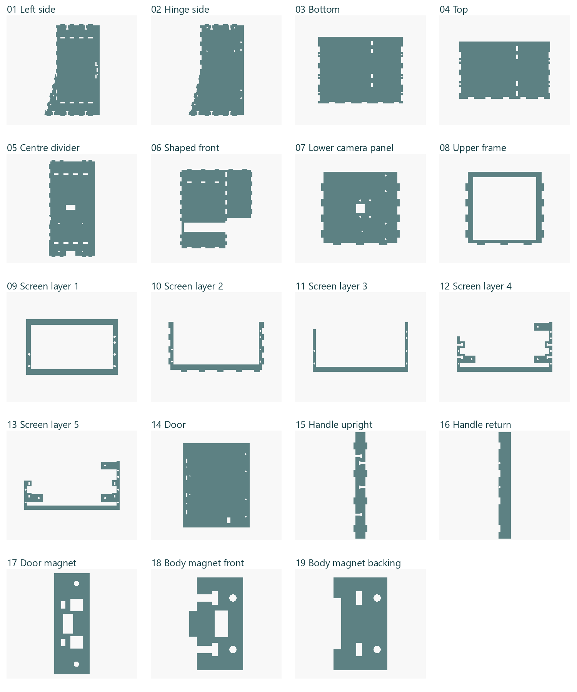
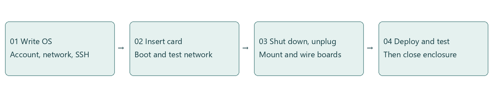
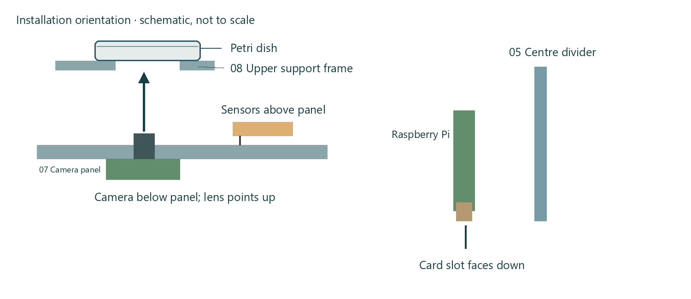
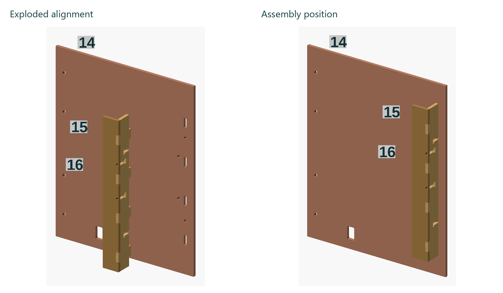
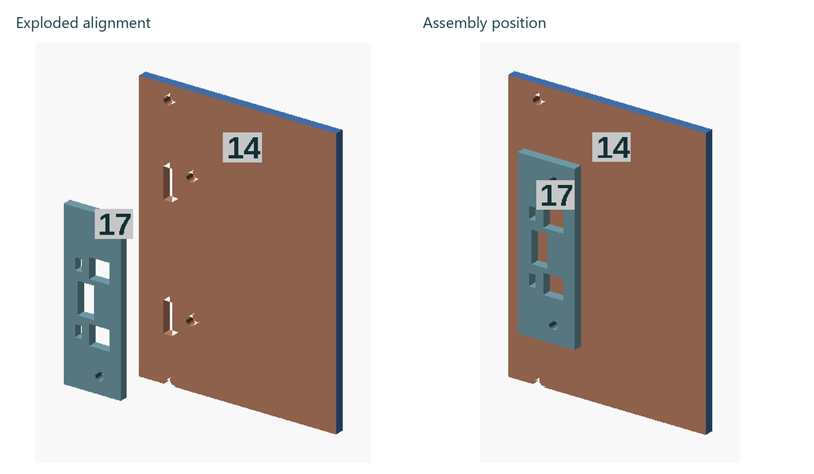
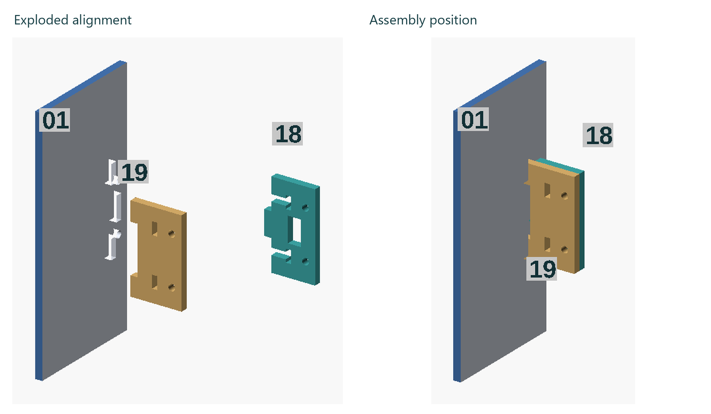
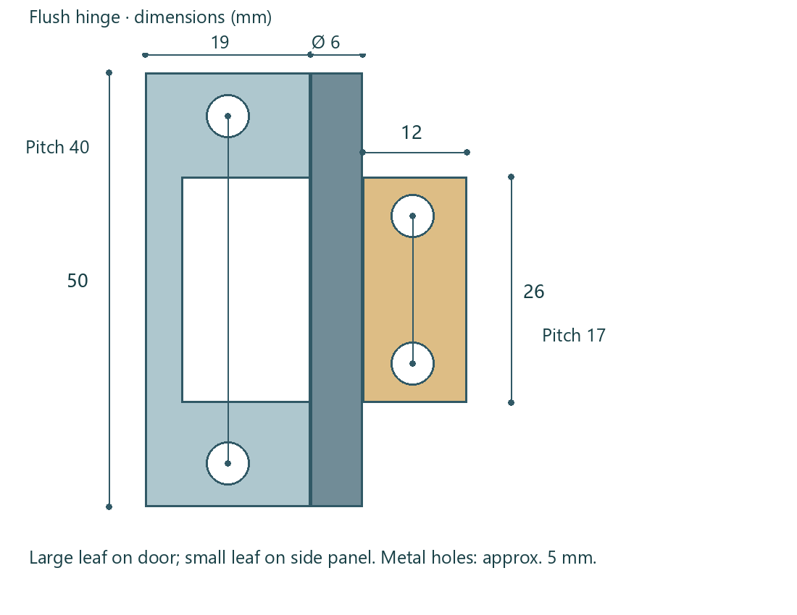
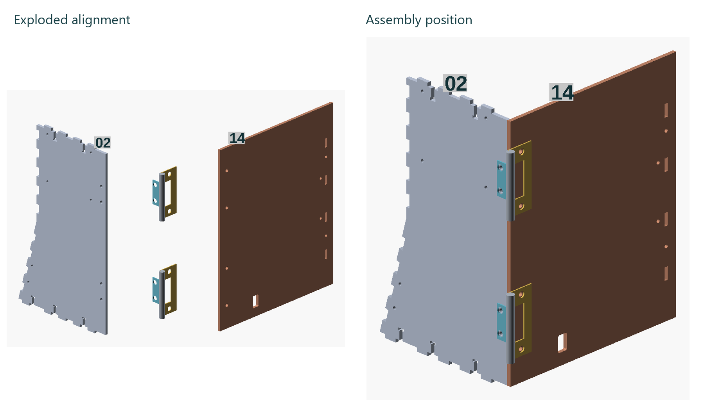

# PetriTrace Assembly and User Manual

Version 1.0 · English

GitHub: J-ShuJie

Project: [https://github.com/J-ShuJie/PetriTrace](https://github.com/J-ShuJie/PetriTrace)

## Contents

- [1. Introduction](#section-1)
  - [1.1 Purpose](#section-1-1)
  - [1.2 Hardware](#section-1-2)
  - [1.3 Software](#section-1-3)
  - [1.4 Using this manual](#section-1-4)
- [2. Materials](#section-2)
  - [2.1 Electronic components](#section-2-1)
  - [2.2 Enclosure and mechanical parts](#section-2-2)
  - [2.3 Design and cutting files](#section-2-3)
- [3. System and firmware preparation](#section-3)
  - [3.1 Raspberry Pi operating system and card](#section-3-1)
  - [3.2 Pico programming](#section-3-2)
  - [3.3 Assembly and deployment order](#section-3-3)
- [4. Electronics and enclosure assembly](#section-4)
  - [4.1 Raspberry Pi and expansion shield](#section-4-1)
  - [4.2 Camera and environmental sensors](#section-4-2)
  - [4.3 Five-layer screen frame](#section-4-3)
  - [4.4 Main frame and lighting](#section-4-4)
  - [4.5 Door, handle and magnets](#section-4-5)
- [5. Wiring and closing the enclosure](#section-5)
- [6. Installation and deployment](#section-6)
  - [6.1 First connection](#section-6-1)
  - [6.2 Remote access with Tailscale](#section-6-2)
  - [6.3 Browser addresses](#section-6-3)
- [7. First run and Petri dish placement](#section-7)
- [8. Capture, review and export](#section-8)
  - [8.1 Capture controls](#section-8-1)
  - [8.2 Environmental and colony history](#section-8-2)
  - [8.3 Detailed records and photos](#section-8-3)
  - [8.4 Export](#section-8-4)
  - [8.5 Delete](#section-8-5)
- [9. Settings, diagnostics and maintenance](#section-9)
- [10. Source, drawings and license](#section-10)

## 1. Introduction

### 1.1 Purpose

PetriTrace is a Raspberry Pi-based system for observing Petri dishes. It consists of an observation device and control software. The device holds the camera, Petri dish and environmental sensors. The software takes scheduled photographs, records temperature and humidity, counts colonies and exports data. You can operate it at the device or view photos and records over a network.

### 1.2 Hardware

The device has an observation area, electronics compartment, screen and door. The camera faces the Petri dish, an LED strip provides illumination, and two temperature and humidity sensors record environmental conditions. The Raspberry Pi runs the camera and web service. A Pico connects to the sensors and LED strip through an expansion shield and communicates with the Raspberry Pi over USB.

### 1.3 Software

The system has three user interfaces:

Table 1. Software interfaces

| Interface | Main functions |
|---|---|
| PetriTrace deployment manager (the manager) | Add devices, deploy software, open the browser interface, diagnose connections, repair and redeploy |
| Browser interface | Use a computer, phone or tablet to take photos, inspect photos and history, adjust settings, export and delete records |
| Device touchscreen | View status and control capture beside the device |

Initial deployment uses the Windows manager. After deployment, the browser interface is accessible from Windows, macOS, phones and tablets.

You can use the software with your own hardware design. To build the enclosure in this manual, use the accompanying DWG cutting layout and OpenSCAD source files.

### 1.4 Using this manual

The manual follows the build sequence: gather materials, prepare the operating system, assemble the electronics and enclosure together, deploy the software and use the device. Allow about 1.5 hours for initial hardware assembly, excluding cutting, system downloads and software deployment.

Follow the chapters in order for a new build. If the hardware is already assembled, go directly to deployment, operation or maintenance. Panel numbers in the illustrations match the parts list. Colours distinguish components.

## 2. Materials

### 2.1 Electronic components

Table 2. Main electronic components

| Component | Quantity | Specification and purpose |
|---|---:|---|
| Raspberry Pi | 1 | Raspberry Pi 5; runs capture, counting and the web service |
| Camera | 1 | Standard Raspberry Pi Camera Module 3, Sony IMX708, autofocus |
| Display | 1 | Raspberry Pi Touch Display 2, 5-inch |
| Pico | 1 | Raspberry Pi Pico WH, with headers and wireless support |
| Expansion shield | 1 | Elecrow Crowtail Shield for Raspberry Pi Pico, CRT02131P |
| Temperature/humidity sensor A | 1 | Seeed Grove TH02 |
| Temperature/humidity sensor B | 1 | Seeed Grove AHT20, 101990644 |
| LED strip | 1 | Seeed Grove WS2813 waterproof RGB strip, 5 V, 60 LEDs/m; supplied as 1 m, cut to the required length |
| Power supply | 1 | Raspberry Pi 27W USB-C Power Supply |
| microSD card | 1 | Holds the operating system and captured records |

Mount the LED strip along the inner wall; a length of no more than about 36 cm is recommended. The example device uses 18 LEDs, about 30 cm. Lighting control covers the whole strip; no LED count setting is needed. The strip has a permanently attached cable.

Table 3. Cables

| Cable | Quantity | Specification |
|---|---:|---|
| Camera ribbon cable | 1 | 15 pins at 1.0 mm pitch at the camera; 22 pins at 0.5 mm pitch at the Pi 5; Standard–Mini |
| Display signal cable | 1 | Pi 5-compatible DSI ribbon supplied with Touch Display 2 |
| Display power cable | 1 | GPIO power cable supplied with Touch Display 2 |
| Pico data cable | 1 | USB-A to Micro-USB, supporting data transfer |
| Sensor cable | 2 | Crowtail 4-pin cable, JST-PH 2.0, 20.5 cm; one per sensor |

### 2.2 Enclosure and mechanical parts

The enclosure consists of 19 panels cut from flat 3 mm sheet material.

Use two flush hinges: large leaf 50 × 19 mm, small leaf 26 × 12 mm, hole spacing 40 mm and 17 mm respectively, barrel diameter 6 mm.

Use two Supermagnete Q-10-05-02-N N50 neodymium magnets, 10 × 5 × 2 mm. Glue them in place.

Table 5 lists screw sizes, quantities and locations. Nut quantities and board spacers are listed below it.

Figure 3 shows the relative positions of the enclosure, handle and magnet panels. Camera panel 07 sits between side panel 01 and divider 05. Panels 09–13 form the five-layer screen frame; see Figure 8. Door connections are shown in section 4.5. Panel numbers match the following table and manufacturing source files. There is one of each panel.

Table 4. Panel numbers

| Number | Panel |
|---|---|
| 01, 02 | Left side panel, hinge side panel |
| 03, 04 | Bottom panel, top panel |
| 05, 06 | Centre divider, large shaped front panel |
| 07, 08 | Lower camera panel, upper frame |
| 09, 10, 11, 12, 13 | Screen layers one to five |
| 14 | Door with vertical power opening |
| 15, 16 | Handle upright, handle return |
| 17 | Door magnet panel |
| 18, 19 | Body magnet front panel, backing panel |

Table 5. Screws by mounting location

| Mounting location | Screw size | Quantity |
|---|---|---|
| Raspberry Pi 5 | M2.5 × 12 | 4 |
| Crowtail shield | M2.5 × 12 | 4 |
| Camera Module 3 | M2 × 8 | 4 |
| Two environmental sensors | M2 × 8 | 3 + 2 |
| Display | M2.5 × 14 | 3 |
| Five-layer screen frame clamp | M2.5 × 18 | 6 |
| Handle upright and return | M2.5 × 12 | 4 |
| Screen frame side connections | M2.5 × 12 | 4 |
| Top/bottom to side panels | M2.5 × 12 | 10 |
| Door magnet panel | M2.5 × 8 | 2 |
| Body magnet front/back clamp | M2.5 × 8 | 2 |
| Body magnet assembly to side panel | M2.5 × 12 | 2 |
| Two hinges | M4 × 6 | 8 |

Total: 58 screws — 9 M2 × 8, 4 M2.5 × 8, 28 M2.5 × 12, 3 M2.5 × 14, 6 M2.5 × 18 and 8 M4 × 6. Lengths refer to the shank, excluding the head.

Use another 12 nuts as board spacers: four M2.5 each for the Raspberry Pi and Crowtail shield, and four M2 for the camera. Each screw also needs one matching fastening nut. Total: 70 nuts — 13 M2 (9 fastening, 4 spacers), 49 M2.5 (41 fastening, 8 spacers) and 8 M4 (all fastening).

### 2.3 Design and cutting files

Two files are provided for the 19-panel enclosure:

Table 6. Design and cutting files

| File | Purpose |
|---|---|
| PetriTrace_19parts_mm_DWG2007.dwg | Panel cutting layout in DWG 2007 format, millimetres, scale 1:1 |
| PetriTrace_OpenSCAD.zip | View the complete enclosure and individual panels, modify the model and export it again |

Install OpenSCAD, extract the archive and open `OpenSCAD/PetriTrace.scad` to view the complete model. Open the corresponding file in `parts` to view an individual panel. Keep the `lib` folder with the other files; it contains the model's supporting files.

Cut 3 mm sheet material at 1:1 scale. Remove burrs from openings and edges, then test the tab-and-slot joints.

## 3. System and firmware preparation

### 3.1 Raspberry Pi operating system and card

Write the operating system and insert the microSD card before mounting the Raspberry Pi. The card slot is difficult to reach afterwards.

1. Open Raspberry Pi Imager. Select Raspberry Pi OS Desktop (64-bit) and the microSD card.
2. In system customization, set the hostname, username, password and network, and enable SSH. Keep these details for the manager.
3. Write the image and wait for writing and verification to finish.
4. Insert the card, power on the Pi and complete its first boot. Confirm that the computer and Pi can reach each other on the local network.
5. Shut down and disconnect power before mounting electronics and connecting ribbon cables.

Install PetriTrace with the manager in chapter 6. A home router or phone hotspot can be used for the first connection. Campus and guest networks must allow communication between devices.

### 3.2 Pico programming

Connect the Pico to the Raspberry Pi with a USB data cable. The manager detects a Pico running MicroPython, backs up its existing program, writes PetriTrace and reads it back for verification. It then restarts the Pico and checks its status response.

Pico WH uses the Pico W MicroPython firmware. Prepare a blank Pico WH as follows:

1. Hold BOOTSEL while connecting the Pico to the computer by USB, then release it.
2. Download the Raspberry Pi Pico W UF2 from the [MicroPython firmware page](https://micropython.org/download/RPI_PICO_W/).
3. Copy it to the RPI-RP2 drive and wait for the Pico to restart.
4. Connect the Pico to the Raspberry Pi. Deployment in chapter 6 writes the PetriTrace program.

### 3.3 Assembly and deployment order

We recommend completing the mounting and wiring before using the manager. Check the camera, sensors and lighting before closing the enclosure. To test the electronics first, follow chapter 6 for deployment and a trial run, then return to chapter 4. Insert the microSD card before mounting the Pi.

## 4. Electronics and enclosure assembly

Mount electronics on their panels first, assemble the frame, then close the enclosure. Align tabs and slots and arrange the cables before tightening connections.

### 4.1 Raspberry Pi and expansion shield

Align the Pi's four mounting holes with divider 05 and secure it with M2.5 screws. The card slot faces down; insert the card beforehand. Leave about 3 mm between the back of the circuit board and the divider to make room for the components on the underside. Matching nuts can serve as spacers. Check that the components do not press against the panel.

Mount the Crowtail shield at the four M2.5 positions on hinge side panel 02. Check the Pico's orientation on the shield and leave room to plug and unplug USB.

Before joining the panels, pass the camera ribbon through the lower opening in divider 05 and the LED/sensor cables through the middle opening. Connect the mounted devices as described in chapter 5 before closing the enclosure. Route cables through the openings and leave clearance for the door.

### 4.2 Camera and environmental sensors

Mount the camera beneath panel 07, with its lens pointing up through the opening towards the observation area. Mount both environmental sensors above panel 07. Use four M2 screws for the camera. In the reference assembly, its ribbon faces the centre divider and runs towards the cable opening.

Sensor A (TH02, 40 × 20 mm) uses three M2 mounting holes. Sensor B (AHT20, 20 × 20 mm) uses two. Align their holes and secure the boards with their connectors accessible.

### 4.3 Five-layer screen frame

From the front of the screen towards the enclosure interior, the order is: 09 outer frame, 10 structural frame, 11 spacer frame, 12 carrier panel, 13 rear reinforcing panel.

The illustration separates the five layers vertically: layer one is at the bottom, followed by layers two to five. In the assembled device they sit together on the sloped screen face.

The 4 mm round holes in layer one receive the screw heads. The other layers have corresponding shank openings. Layer four has side T-slots; layer five has small supporting slots. Stack the panels in the stated order and orientation.

Secure the display with three M2.5 × 14 screws. Test its fit and check clearance for the display area, connectors and screw heads, then tighten evenly. Use 18 mm screws to clamp the frame, and M2.5 × 12 screws for the side connections, two on each side.

Connect the signal and power cables, then fit the screen assembly into the enclosure.

### 4.4 Main frame and lighting

Use bottom panel 03 as the base. Test-fit divider 05, the side panels carrying electronics, front panel 06 and screen assembly 09–13. Fit camera panel 07 and upper frame 08, aligning tabs and slots. Leave room for wiring. You can leave the top panel off until after the functional checks. Other outer panels can also be left off temporarily if the frame remains stable.

Arrange the LED strip along the inner wall to illuminate the dish evenly without obstructing the camera. A total length of no more than about 36 cm is recommended. Fix it with double-sided tape or another suitable tape. For later disassembly, choose tape that removes easily with little residue. Keep cables clear of the lens, panel joints and door.

### 4.5 Door, handle and magnets

Panels 15 and 16 form the handle: upright 15 is perpendicular to the door; return 16 is parallel and 18 mm wide. Insert the upright's outer tabs into the return's slots, place nuts in the upright's T-slots, and pass screws through the return panel's round holes into the nuts. Insert the upright's inner tabs into door 14 and tighten its door connections.

Fix magnet panel 17 inside door 14, aligning its two round holes with the door's mounting holes. Glue the magnet into the central rectangular opening.

Stack front panel 18 and backing panel 19. Insert their offset tabs into side panel 01. The front panel holds the magnet; the backing panel supports it. Tighten the clamping screws, check that the body and door magnets attract, and glue them in place.

Each hinge has a large leaf 50 mm long with a 19 mm flat width, a small leaf 26 mm long with a 12 mm flat width, and a barrel diameter of 6 mm. Hole-centre spacing is 40 mm on the large leaf and 17 mm on the small leaf. The measured metal through-holes are about 5 mm; the panels have tight 3.5 mm mounting holes. Use four M4 × 6 screws per hinge.

Fix the large leaf to door 14 and the small leaf to side panel 02. The distance from the side panel edge to the hinge's outer straight metal edge is 11.5 mm. Align both hinge axes, then open and close the door to check movement.

## 5. Wiring and closing the enclosure

Connect devices as listed below, checking the labels on the Pico and shield.

Table 7. Wiring

| From | To | Connection |
|---|---|---|
| Official power supply | Raspberry Pi USB-C power port | Pi power |
| Raspberry Pi USB-A | Pico WH Micro-USB | USB data |
| Raspberry Pi camera connector | Camera Module 3 ribbon connector | Camera signal |
| Raspberry Pi display connector | Touch Display 2 ribbon connector | Display signal |
| Raspberry Pi physical GPIO pins 2 (5 V) and 6 (GND) | Display power connector | Red to 5 V, black to GND |
| Shield I2C1 | Sensor A | SDA=GP6, SCL=GP7, address 0x40 |
| Shield I2C2 | Sensor B, AHT20 | SDA=GP8, SCL=GP9, address 0x38 |
| Shield D2 | Attached LED strip cable | GP18 lighting control |

Close the ribbon connector latches and arrange the cables, then power on and deploy the software as described in chapter 6. Open the browser interface, check both sets of environmental readings and the light switch, and take a test photograph. Close the remaining panels after confirming that camera, sensors and lighting work. Disconnect power before changing internal connections.

## 6. Installation and deployment

Download the PetriTrace installer for Windows from the project's [Releases page](https://github.com/J-ShuJie/PetriTrace/releases). Install it and open the PetriTrace manager. Setup includes the deployment files. Source code and hardware drawings are provided separately in the repository.

### 6.1 First connection

The screenshots use English. Addresses, accounts, network names and paths are examples. Figures 15 and 17 show connection parameters and installation options in the repair and redeployment flow. The initial deployment wizard uses the same parameters and options, with a different layout and number of steps.

1. Put the Windows computer and Raspberry Pi on a local network where they can reach each other. Prepare the Pi's system, network and SSH first.
2. Open the manager. With no device configured, it opens the initial deployment wizard. For a configured device, use repair and redeployment to update the installation.
3. Enter the Pi hostname or IP address, SSH username, and password or private key created during system preparation.
4. On first connection, check the SSH host identity prompt and confirm that it is your device.
5. Select touchscreen and network options. For remote access, configure Tailscale as described in section 6.2, then begin deployment. If sudo authentication is required, enter the Pi system user's password. With SSH password login, an empty administrator (sudo) password field reuses the SSH password. With private-key login, supply the sudo password separately when required.
6. Wait for upload, dependency installation, Pico programming, service startup and health checks to complete, then open the browser interface.

The touchscreen option configures desktop auto-login and browser startup. After a Pi restart, the touchscreen opens the control interface automatically.

### 6.2 Remote access with Tailscale

Tailscale provides access to the Pi from other networks. Register or sign in to your own Tailscale account, install Tailscale on the Pi through the manager, and authorize the device in your browser.

On the installation mode page, select “Configure optional Tailscale remote access”. “Open Tailscale download page” opens the download site. After installing and signing in on your computer, click “Check again”. During deployment, follow the browser authorization prompt for the Pi.

Enter the Pi's Tailscale address in its device configuration. Install Tailscale on the remote computer or phone too, and join the same authorized network. On the local network, use the Pi's local address directly.

### 6.3 Browser addresses

The manager overview displays separate local-network and Tailscale addresses. Click “Copy URL”, then paste the address into a browser on the other device. The local address is for devices on the same LAN; the Tailscale address is for devices connected to the authorized network. “Open control interface” opens it on the current computer. You can also enter:

`http://<raspberry-pi-address>:5000`

Replace the entire placeholder, including angle brackets, with the actual hostname, local IP or reachable Tailscale address. If you changed the web port, use the URL shown by the manager.

## 7. First run and Petri dish placement

Check that the page reports an available camera, both environmental readings and working lighting controls.

Open the door and place the dish on upper frame 08. The camera photographs it from below; see Figure 7. Take a test photo and check that the whole dish is visible and evenly lit. Move the dish and repeat if necessary. Parts of the compartment walls may appear at the sides; the dish should fit fully within the image.

Check the test photo's timestamp and record, compare its colony count with the photo, and try exporting. Then begin long-term recording.

The touchscreen, computer and phone all control the same Pi. Starting or stopping capture from any interface changes the task running on that device.

## 8. Capture, review and export

### 8.1 Capture controls

Set and apply the capture interval, then start scheduled capture. The task continues on the Pi until you click “Stop”. Use single capture for an extra photograph.

Lighting lead time and hold time after capture are in seconds. Brightness ranges from 0 to 1.

“Stop Pi Web service on exit” controls whether closing the manager also stops the Pi's web service.

### 8.2 Environmental and colony history

Choose the last day, last three days, last week, all records or a custom time range. Charts plot data by record time. Switch between OpenCFU and MCount colony results.

Hover over a point to preview its data. Clicking a chart point or a detailed record highlights the corresponding entries in both chart and list. While pinned, moving the mouse does not select another record. Selecting a record does not scroll the page or change the page shown in the records list. If the matching record is on another page, use the pagination controls to find it.

Click an empty area, click the selected record again or press Esc to unpin it and restore hover preview.

### 8.3 Detailed records and photos

The photos in this section show a black-dot test target on white paper to demonstrate record viewing.

Detailed records are shown in pages. Use the list controls to choose how many records appear on each page. Click a thumbnail to view a larger photo and use the left/right buttons to browse. Highlighting a record links it to the chart; selecting its checkbox prepares it for batch actions.

The photo viewer initially fits the whole image. Zoom in for detail, export the record or download the original image. The background page stays in place while the viewer is open.

### 8.4 Export

Use “Export” at the top of the page for the current range, a custom range or all records. To export an individual record or checked records, use the export control in Detailed records.

Available content includes original photos, colony counts, temperature and humidity recorded at capture, and independent environmental records. “Select all” checks every category. The browser remembers the last selection; initially nothing is selected. You may need to select again after changing browser or address, or clearing site data.

Export from Detailed records includes only the selected capture records and their associated data. A single data category without photos produces CSV. Photos or multiple categories produce ZIP. The browser downloads the file.

### 8.5 Delete

Use the row's “Delete” action for one record, or check records and choose “Delete selected” for a batch, then confirm. Deletion removes the photo, colony counts and environmental readings taken with that photo. Temperature and humidity recorded independently remain in environmental history.

## 9. Settings, diagnostics and maintenance

“Refresh” updates status, charts and records. To reload the entire page, use the circular arrow between the monitor and diagnostics icons. After a software update, it indicates that a reload is available. The touchscreen reloads automatically when idle with no dialog open. Deployment also restarts the touchscreen browser.

The manager handles connection and deployment maintenance; browser settings handle daily operation. On first launch, the manager uses Chinese, German or English according to the computer's language, with English as the fallback. The first deployment applies the manager language to the web interface. Both interfaces then let you change and save their language independently.

Browser settings are grouped into General, Capture and lighting, and External storage. Save changes after editing. Check connection and capacity before using external storage, and safely eject it before removal. Diagnostics shows current issues and runtime information. Screen inspection tools show what is displayed on the touchscreen.

You can dismiss an issue notification at the top. Dismissal hides the notification while preserving the issue and recent records in Diagnostics. The same browser at the same address remembers dismissed notifications; new issue records still trigger a notification.

Table 8. Troubleshooting

| Situation | What to check |
|---|---|
| Manager cannot find the Pi | Power, device address, SSH and local connectivity; open connection diagnostics |
| Local access works, remote access fails | Check that Tailscale is online on both devices, that your account has access, and that you are using the Pi's Tailscale address |
| Web page does not open | Pi URL, port and service status |
| Only part of the LED strip lights | Wiring, strip model and whether the Pico program is current |
| Sensor data missing | Module model, pin order, I2C connections, Pico firmware and USB data cable |
| Touchscreen does not open the interface automatically | Desktop OS, Labwc desktop, auto-login and deployment options |
| Blurred photos or unstable focus | Lens and dish, LED strip obstructing the view, lighting stability; take a test photo before continuous recording |
| Storage full | Export and check records to retain, then choose deletion or another storage destination |

Use repair and redeployment to maintain an existing installation. Back up photos, databases and configuration first.

Shut down the operating system before disconnecting power.

For unresolved problems, describe the steps, error message and software version on the project's [Issues page](https://github.com/J-ShuJie/PetriTrace/issues), with relevant diagnostic information. Remove passwords, private keys and other private details before submitting.

## 10. Source, drawings and license

The repository is [https://github.com/J-ShuJie/PetriTrace](https://github.com/J-ShuJie/PetriTrace), under the GitHub account J-ShuJie. Software, drawings and manual source are organized by purpose; installers are available from [Releases](https://github.com/J-ShuJie/PetriTrace/releases). Modify the program for your observations or use your own enclosure. DWG is for manufacturing; OpenSCAD is for changing model shapes and dimensions. Adapt wiring, configuration and assembly instructions to any hardware changes.

The project's own content uses the MIT License. Retain its copyright and license notices. Third-party components retain their own licenses, as listed in the repository's license files and third-party notices.
