# PetriTrace 制作与使用手册

版本 1.0 · 中文

GitHub账号：J-ShuJie

项目仓库：[https://github.com/J-ShuJie/PetriTrace](https://github.com/J-ShuJie/PetriTrace)

## 目录

- [1. 项目简介](#section-1)
  - [1.1 项目用途](#section-1-1)
  - [1.2 硬件组成](#section-1-2)
  - [1.3 软件组成](#section-1-3)
  - [1.4 手册使用说明](#section-1-4)
- [2. 材料准备](#section-2)
  - [2.1 主要电子件](#section-2-1)
  - [2.2 外壳与机械件](#section-2-2)
  - [2.3 设计与加工文件](#section-2-3)
- [3. 系统与固件准备](#section-3)
  - [3.1 树莓派系统与存储卡](#section-3-1)
  - [3.2 Pico程序写入](#section-3-2)
  - [3.3 装配与部署顺序](#section-3-3)
- [4. 电子件与外壳装配](#section-4)
  - [4.1 树莓派与扩展板](#section-4-1)
  - [4.2 相机与环境传感器](#section-4-2)
  - [4.3 五层屏幕框](#section-4-3)
  - [4.4 主框体与照明](#section-4-4)
  - [4.5 门、把手与磁吸组件](#section-4-5)
- [5. 接线与封合检查](#section-5)
- [6. 安装软件与部署](#section-6)
  - [6.1 首次连接](#section-6-1)
  - [6.2 Tailscale远程访问](#section-6-2)
  - [6.3 网页地址](#section-6-3)
- [7. 首次运行与培养皿放置](#section-7)
- [8. 拍摄、查看和导出](#section-8)
  - [8.1 拍摄控制](#section-8-1)
  - [8.2 环境与菌落历史](#section-8-2)
  - [8.3 详细记录与照片](#section-8-3)
  - [8.4 导出](#section-8-4)
  - [8.5 删除](#section-8-5)
- [9. 设置、诊断与维护](#section-9)
- [10. 源码、图纸与许可](#section-10)

## 1. 项目简介

### 1.1 项目用途

PetriTrace是一套基于树莓派的培养皿观察工具，由观察装置和控制软件组成。装置负责固定相机、培养皿及环境传感器，软件负责定时拍照、温湿度记录、菌落计数和数据导出。使用者可以在设备旁操作，也可以通过网络查看照片与历史记录。

### 1.2 硬件组成

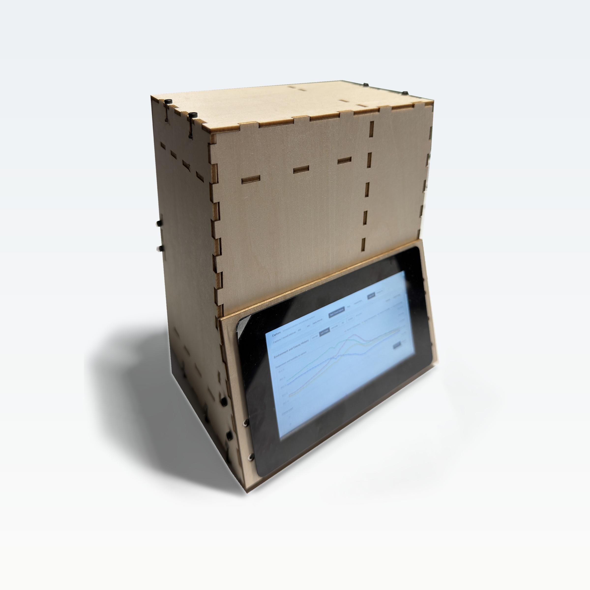

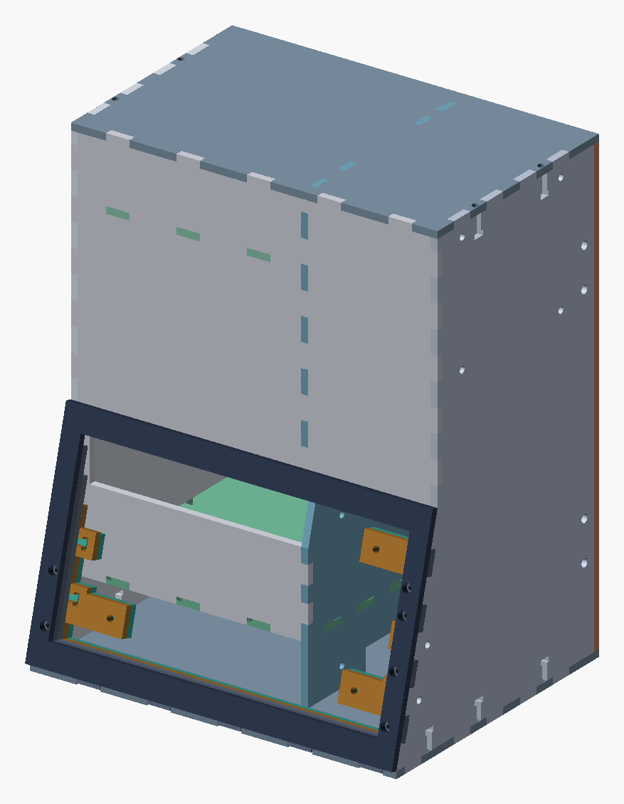

装置由观察区域、电子舱、屏幕和活动门组成。相机朝向培养皿，灯带提供照明，两路温湿度传感器提供环境记录。树莓派运行拍摄和网页服务；Pico通过扩展板连接传感器与灯带，再经USB与树莓派通信。

### 1.3 软件组成

可以通过以下三个入口使用这套软件：

表 1　软件使用入口

| 入口 | 主要用途 |
|---|---|
| PetriTrace部署管理器（下文简称“管理器”） | 添加设备、部署软件、打开控制台、诊断连接、修复与重新部署 |
| 浏览器控制台 | 支持电脑、手机和平板等设备的浏览器访问；拍照、查看照片与历史、调整参数、导出和删除记录 |
| 装置触摸屏 | 在设备旁查看运行状态、控制拍摄。 |

首次部署使用Windows版管理器。部署完成后，可在Windows、macOS、手机和平板的浏览器中访问控制台。

只使用软件时，可以采用自己的硬件结构。制作本手册中的外壳时，使用配套DWG加工图和OpenSCAD设计源文件。

### 1.4 手册使用说明

本手册按实际制作顺序介绍材料准备、系统写入、电子件与外壳交替装配、软件部署及日常使用。初次硬件装配预计约1.5小时，不包括切割加工、系统下载和软件部署。

从头制作时按章节顺序操作；装置已完成硬件装配时，可直接查阅软件部署、日常使用和维护章节。图中的板件编号与材料表一致，颜色用于区分部件。

## 2. 材料准备

### 2.1 主要电子件

表 2　主要电子部件

| 部件 | 数量 | 规格与用途 |
|---|---:|---|
| 树莓派 | 1 | Raspberry Pi 5，运行拍摄、计数与网页服务 |
| 相机 | 1 | Raspberry Pi Camera Module 3标准款，Sony IMX708，自动对焦 |
| 显示屏 | 1 | Raspberry Pi Touch Display 2，5英寸 |
| Pico | 1 | Raspberry Pi Pico WH，带排针与无线功能 |
| 扩展板 | 1 | Elecrow Crowtail Shield for Raspberry Pi Pico，CRT02131P |
| 温湿度传感器A | 1 | Seeed Grove TH02 |
| 温湿度传感器B | 1 | Seeed Grove AHT20，101990644 |
| 灯带 | 1 | Seeed Grove WS2813 RGB防水灯带，5 V、60 LED/m；商品原长1 m，安装时使用其中一段 |
| 电源 | 1 | Raspberry Pi 27W USB-C Power Supply（树莓派官方27 W USB-C电源） |
| microSD卡 | 1 | 安装操作系统并储存拍摄记录 |

灯带沿内壁安装，建议长度不超过约36 cm。示例装置使用18颗灯珠，约30 cm。照明控制作用于整条灯带，无需设置灯珠数量。灯带自带固定连接线。

表 3　连接线用量与规格

| 连接线 | 数量 | 规格与说明 |
|---|---:|---|
| 相机排线 | 1 | 相机端15针、1.0 mm间距；Pi 5端22针、0.5 mm间距，Standard–Mini规格 |
| 屏幕信号排线 | 1 | 使用Touch Display 2随附、适配Pi 5的DSI排线 |
| 屏幕供电线 | 1 | 使用Touch Display 2随附GPIO供电线 |
| Pico数据线 | 1 | USB-A转Micro-USB，需支持数据传输 |
| 传感器连接线 | 2 | Crowtail四针连接线，JST-PH 2.0、20.5 cm；每个传感器一根 |

### 2.2 外壳与机械件

外壳由19块板件组成，使用平直的3 mm厚板材。

子母合页2个，大片50×19 mm、小片26×12 mm，孔中心距分别为40 mm和17 mm，轴筒直径6 mm。

磁铁使用Supermagnete Q-10-05-02-N，N50钕磁铁，10×5×2 mm，共2块，采用胶粘固定。

螺丝的安装位置、规格和数量见表5。螺母数量及用于垫高电路板的规格见表后说明。

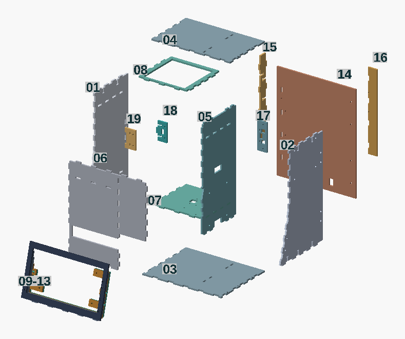

图3展示框体、把手和磁吸板件的三维位置。07号相机板位于01号侧板与05号中隔板之间。09—13号为同一组五层屏幕框，层次见图8；门组件连接关系见第4.5节。板件编号与下表及加工源文件一致，每种板件各一块。

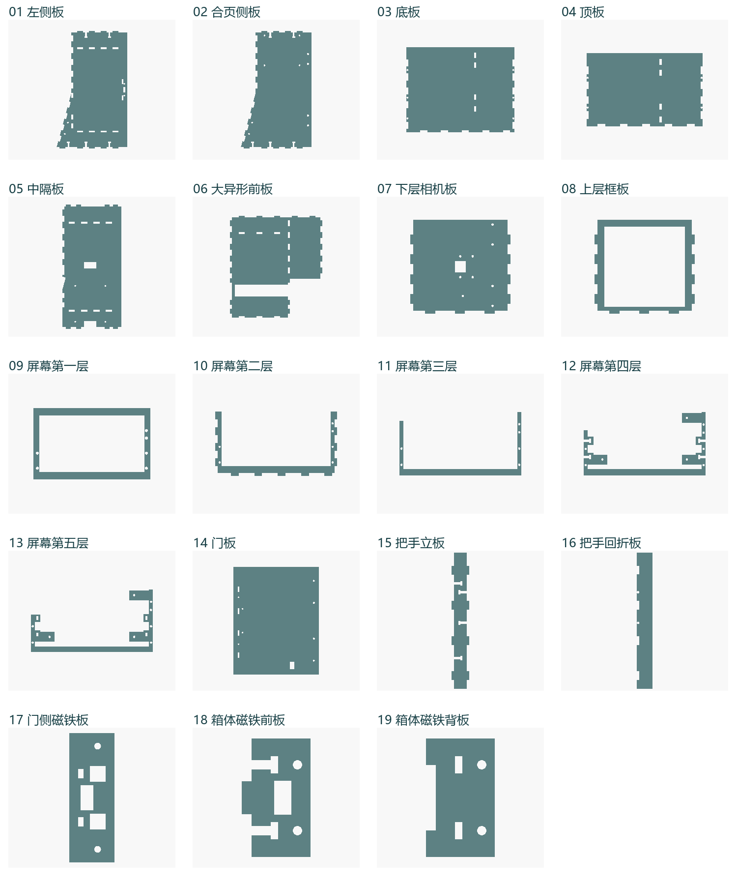

表 4　板件编号

| 编号 | 板件 |
|---|---|
| 01、02 | 左侧板、合页侧板 |
| 03、04 | 底板、顶板 |
| 05、06 | 中隔板、大异形前板 |
| 07、08 | 下层相机板、上层框板 |
| 09、10、11、12、13 | 屏幕第一至第五层 |
| 14 | 活动门板，带竖向电源开口 |
| 15、16 | 把手立板、回折板 |
| 17 | 门侧磁铁板 |
| 18、19 | 箱体磁铁前板、背板 |

表 5　紧固件安装位置、规格与数量

| 安装位置 | 螺丝规格 | 安装数量 |
|---|---|---|
| 树莓派5 | M2.5×12 | 4 |
| Crowtail扩展板 | M2.5×12 | 4 |
| Camera Module 3 | M2×8 | 4 |
| 两块温湿度模块 | M2×8 | 3＋2 |
| 显示屏本体 | M2.5×14 | 3 |
| 五层屏幕框夹紧 | M2.5×18 | 6 |
| 把手立板与回折板 | M2.5×12 | 4 |
| 屏幕框侧向连接 | M2.5×12 | 4 |
| 上下板与侧板连接 | M2.5×12 | 10 |
| 门侧磁铁板固定 | M2.5×8 | 2 |
| 箱体磁铁前后板夹紧 | M2.5×8 | 2 |
| 箱体磁铁组件与侧板连接 | M2.5×12 | 2 |
| 两个合页 | M4×6 | 8 |

螺丝共58颗：M2×8为9颗，M2.5×8为4颗，M2.5×12为28颗，M2.5×14为3颗，M2.5×18为6颗，M4×6为8颗。表中长度均为螺杆长度，不含螺丝头。

另用12颗螺母垫高电路板：树莓派和Crowtail扩展板各4颗M2.5，相机4颗M2。每颗螺丝配1颗同规格紧固螺母，再加上述12颗垫高螺母。螺母共70颗：M2为13颗（紧固9、垫高4），M2.5为49颗（紧固41、垫高8），M4为8颗（全部用于紧固）。

### 2.3 设计与加工文件

外壳共19块板件，提供以下两份文件：

表 6　设计与加工文件

| 文件 | 用途 |
|---|---|
| PetriTrace_19parts_mm_DWG2007.dwg | 用于板材切割。文件已排版，采用DWG 2007格式，单位为毫米，比例为1:1。 |
| PetriTrace_OpenSCAD.zip | 用于查看整机和各块板件、修改模型及重新导出。 |

安装OpenSCAD后，解压文件包，用OpenSCAD打开 `OpenSCAD/PetriTrace.scad`，即可查看整机模型。查看单块板件时，打开 `parts` 文件夹中的对应文件。`lib` 文件夹包含模型所需的配套文件，请与其他文件一起保留。

切割使用3 mm厚板材，并保持图纸的1:1比例。加工后清理孔槽和板件边缘的毛刺，再试装榫槽。

## 3. 系统与固件准备

### 3.1 树莓派系统与存储卡

在树莓派固定进外壳前完成系统写入并插好microSD卡。安装后卡槽不易操作。

1. 打开Raspberry Pi Imager，选择带桌面的Raspberry Pi OS（64位）Desktop版本，并选择要写入的microSD卡。
2. 在系统自定义中设置设备名、用户名、密码和网络，启用SSH。记录这些信息，后续管理器会用到。
3. 确认设置后写入系统，等待写入与校验完成。
4. 将卡插入树莓派，通电完成首次启动，并确认电脑与树莓派能够在局域网互访。
5. 确认系统正常后关机、断电，再进行电子件固定和排线连接。

PetriTrace软件将在第6章通过管理器安装。首次连接可使用家用路由器或手机热点；使用校园网或访客网络时，需开启设备间互访。

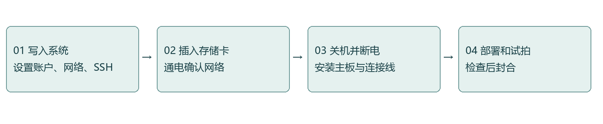

### 3.2 Pico程序写入

Pico通过USB数据线接到树莓派。管理器会识别运行MicroPython的Pico，备份原程序，写入PetriTrace程序，并回读校验。写入后自动重启Pico，检查状态响应。

Pico WH使用Pico W对应的MicroPython固件。首次使用的空白Pico WH按以下步骤安装：

1. 按住Pico上的BOOTSEL键，将USB线接到电脑，松开按键。
2. 在[MicroPython固件页面](https://micropython.org/download/RPI_PICO_W/)下载Raspberry Pi Pico W对应的UF2文件。
3. 把UF2文件复制到电脑中出现的RPI-RP2磁盘，等待Pico自动重启。
4. 将Pico接到树莓派；PetriTrace程序将在第6章的部署过程中写入。

### 3.3 装配与部署顺序

建议先完成部件安装和接线，再使用管理器；最终封合前检查相机、传感器与照明。如果希望先验证电子件，也可以先阅读第6章进行部署和试运行，然后返回第4章完成装配。存储卡必须在主板固定前插好。

## 4. 电子件与外壳装配

先安装各块板上的电子件，再组合框体，最后封合。试合时对齐榫槽，安排线缆方向，再紧固连接。

### 4.1 树莓派与扩展板

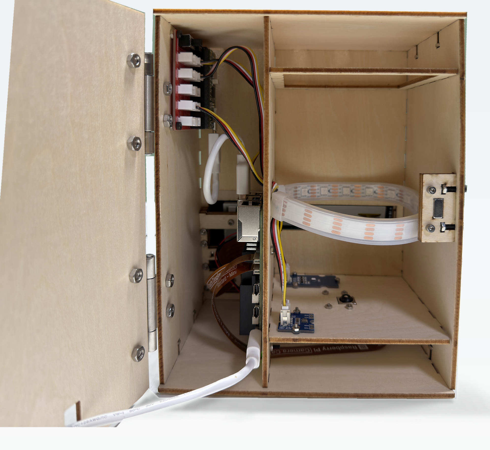

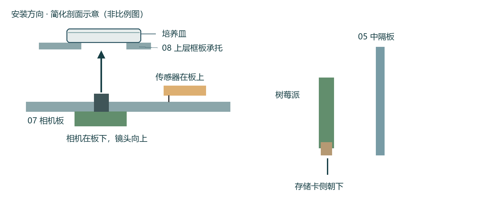

将树莓派的四个安装孔对准05号中隔板上的对应孔位，用M2.5螺丝固定。安装时，存储卡插槽一侧朝下，并提前插好存储卡。树莓派背面与中隔板之间预留约3 mm，以容纳背面的元器件。可使用对应螺母垫高，安装后检查板背面没有压在板材上。

Crowtail扩展板固定在02号合页侧板的4处M2.5安装位置。Pico安装到扩展板时核对方向，USB线保留插拔空间。

合拢板件前，将相机排线穿过05号中隔板下方开口，将灯带和传感器连接线穿过中间开口。相应器件固定后，按第5章连接各端口，在封合前完成插接。沿预留开口整理线缆，留出活动门的转动空间。

### 4.2 相机与环境传感器

相机固定在07号相机板下方，镜头从下向上对准预留口，朝向观察区域。两块温湿度传感器安装在07号相机板上方。相机采用4颗M2螺丝固定。标准方案的相机排线朝中隔板方向，引向预留走线开口。

传感器A（TH02，40×20 mm）安装在3处M2孔位上；传感器B（AHT20，20×20 mm）安装在2处M2孔位上。对准模块孔位后固定，接口朝向便于接线的一侧。

### 4.3 五层屏幕框

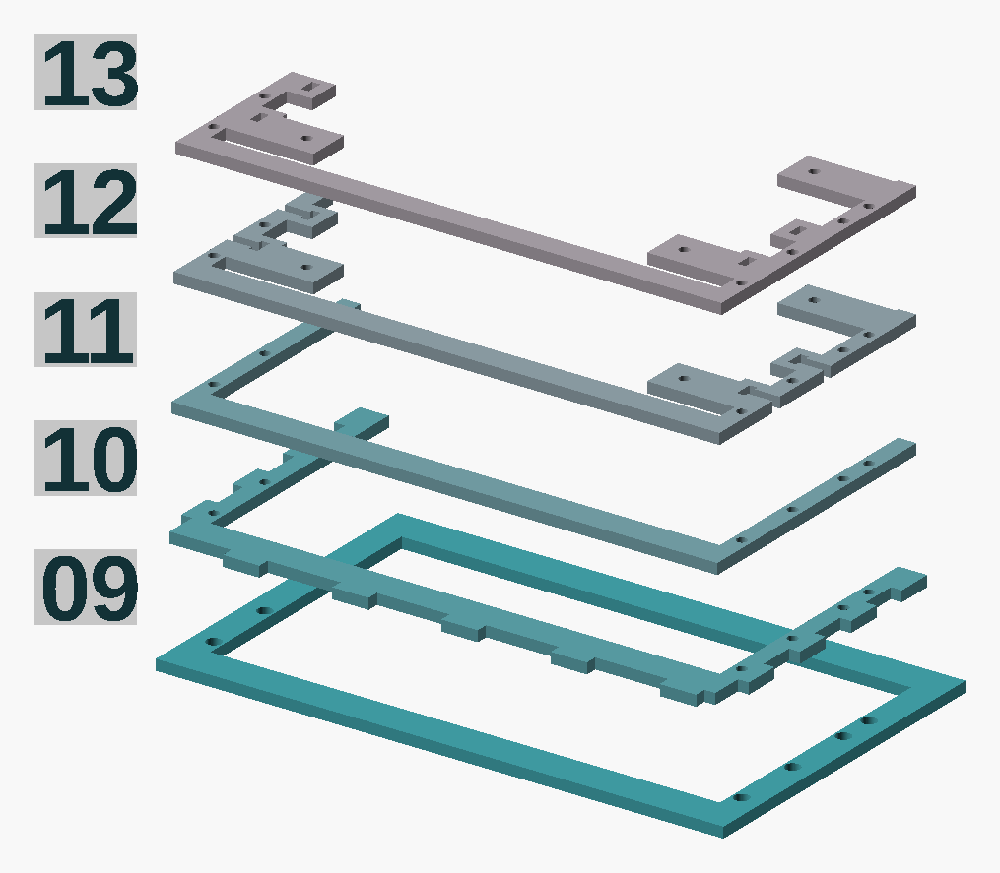

从屏幕正面向箱体内部，依次为：09号第一层外框、10号第二层结构框、11号第三层间隔框、12号第四层承载板、13号第五层后补强板。

上图将五层板件分开展示：最下方是第一层，向上依次为第二至第五层。实际安装时，五层板件叠合在箱体的倾斜屏幕面上。

第一层的4 mm圆孔用于容纳螺丝头，其余各层留有对应的螺杆通道。第四层有侧向T槽，第五层有承托小槽。按上述顺序和图示方向叠放五层板件。

屏幕本体使用3颗M2.5×14固定。先试合屏幕，确认显示区域、接口和螺丝头有空间，再逐步均匀紧固。板框夹紧使用18 mm长螺丝；侧向连接使用M2.5×12，左右各2处。

接好屏幕信号与供电线后，将屏幕组件装入框体。

### 4.4 主框体与照明

以03号底板作为支撑，将05号中隔板、已固定电子件的侧板、06号前板及09—13号屏幕框组件逐步试装到框体上。装入07号相机板与08号上层框板，对齐各板件的榫槽。为接线留出足够的操作空间。顶板可以留到检查后再装。其他外板也可暂缓安装，前提是框体仍能保持稳定。

灯带沿内壁安排，建议总长不超过约36 cm。位置以培养皿照明均匀、相机视野无遮挡为准。灯带用双面胶或适合的胶带固定在内壁。需要日后拆卸时，可选择容易移除、残胶较少的固定材料。线材避开镜头、板缝和活动门。

### 4.5 门、把手与磁吸组件

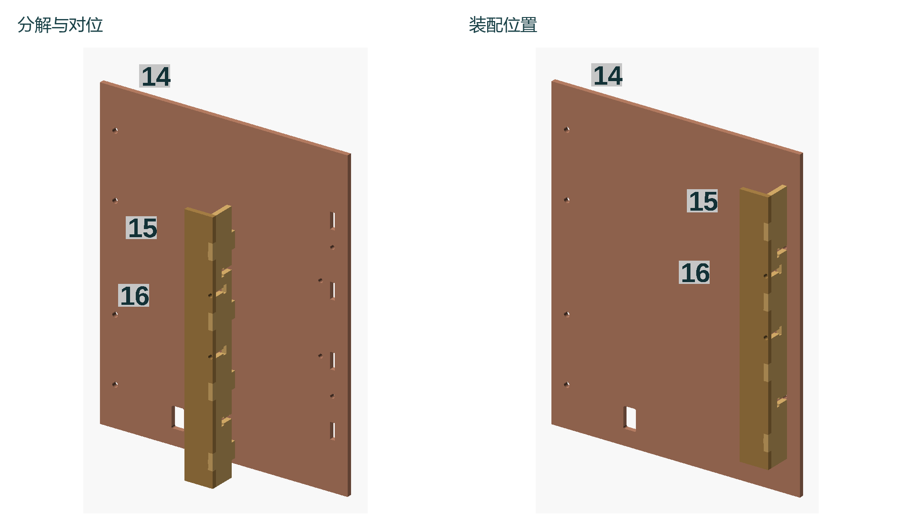

15号立板与16号回折板组成把手：立板垂直于门，回折板平行于门，宽18 mm。先将立板外侧榫舌插入回折板的槽口，在立板对应的T槽内放入螺母，再将螺丝穿过回折板圆孔拧入螺母。随后将立板内侧榫舌插入14号门板的对应开口，拧紧与门板连接的螺丝。

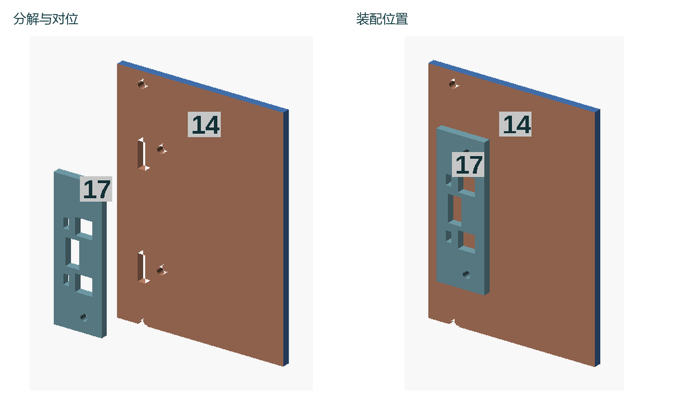

17号磁铁板固定在14号门板内侧，两个圆孔对准门板上的固定孔。磁铁胶粘在中间的长方形开口内。

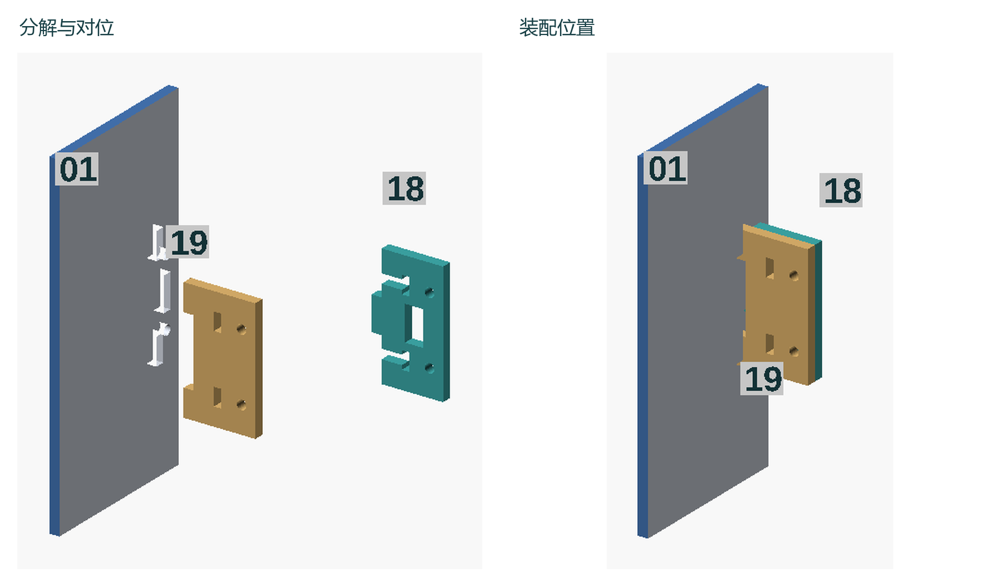

将18号前板与19号背板叠合，再将两块板上错开的榫舌分别插入01号侧板。前板容纳磁铁，背板承托磁铁。拧紧夹紧螺丝后，检查箱体磁铁与门侧磁铁的吸合方向，再胶粘固定。

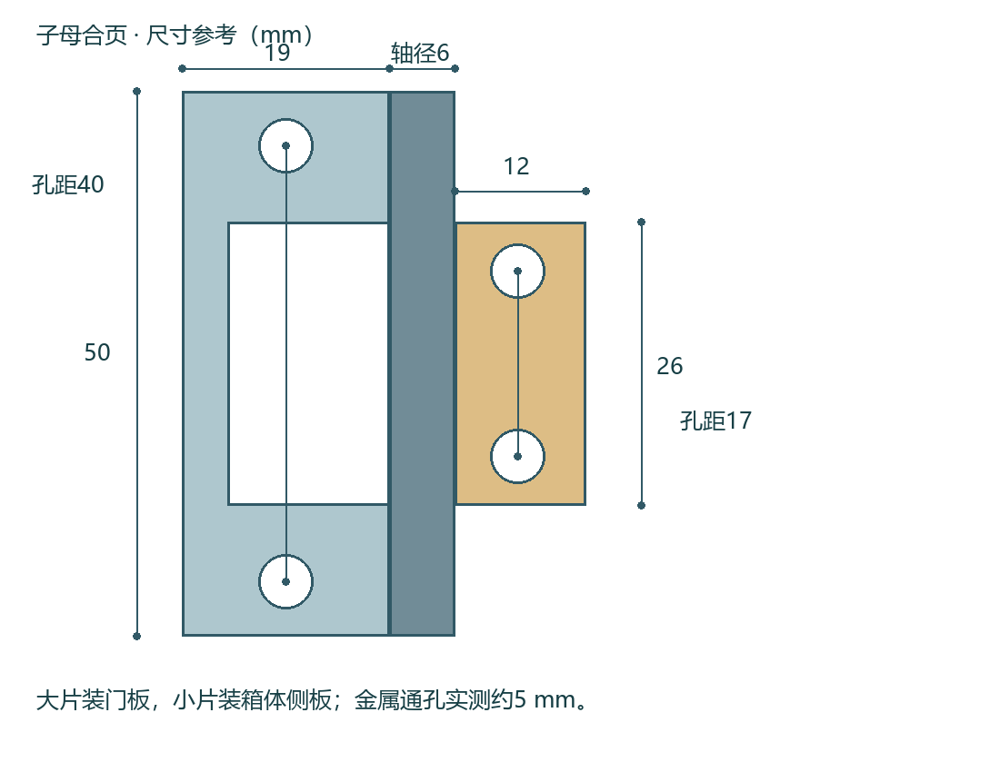

两个子母合页的大片各长50 mm、平边宽19 mm，小片各长26 mm、平边宽12 mm；轴筒直径6 mm。大片两孔中心距40 mm，小片两孔中心距17 mm。金属通孔实测约5 mm，板件上的安装孔为3.5 mm紧孔。每个合页使用4颗M4×6螺丝。

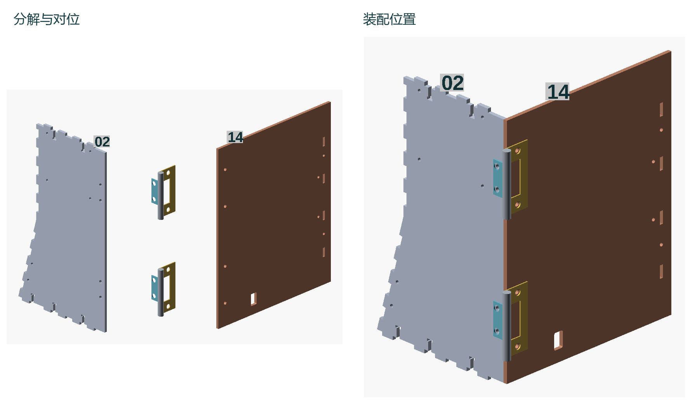

大片固定到14号门板，小片固定到02号侧板。侧板边缘至合页金属外直边为11.5 mm。上下两个合页的转轴对齐，装好后开关门检查转动情况。

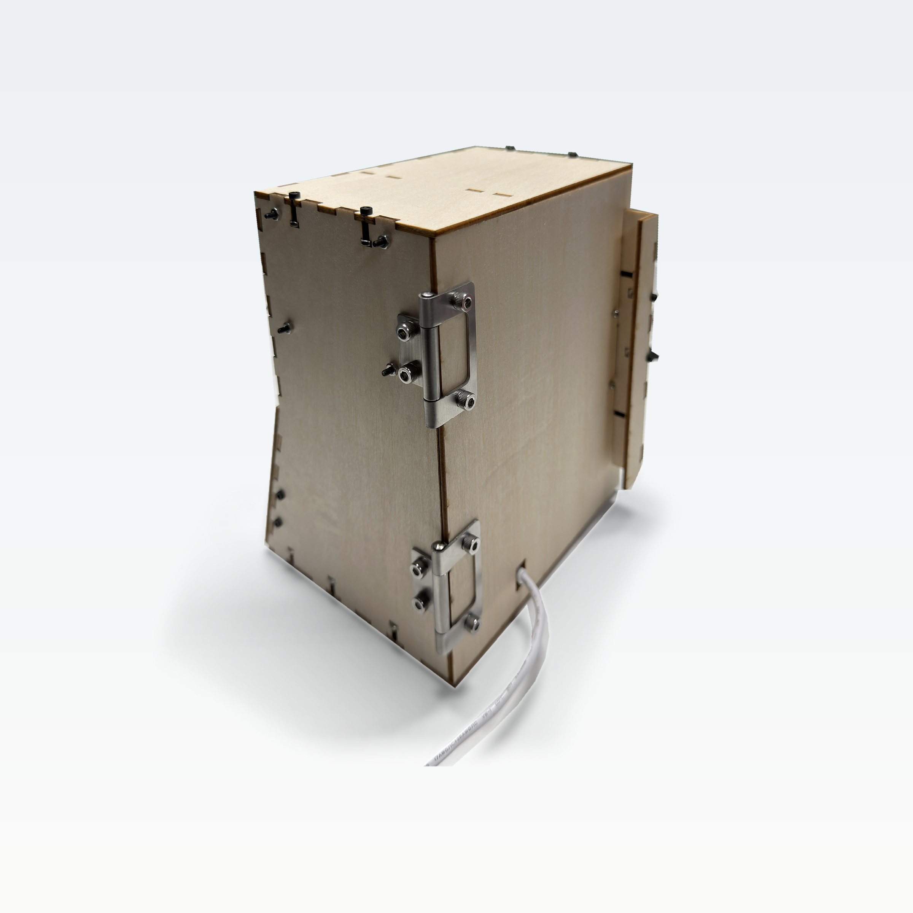

## 5. 接线与封合检查

按下表连接各设备，并核对Pico与扩展板上的端口丝印。

表 7　设备连接关系

| 起点 | 终点 | 连接用途 |
|---|---|---|
| 官方电源 | 树莓派USB-C电源口 | 为树莓派供电 |
| 树莓派USB-A口 | Pico WH的Micro-USB口 | USB数据通信 |
| 树莓派相机连接器 | Camera Module 3排线座 | 相机信号 |
| 树莓派显示连接器 | Touch Display 2排线座 | 显示信号 |
| 树莓派GPIO物理脚2（5 V）、6（GND） | 屏幕供电接口 | 红线接5 V，黑线接GND |
| 扩展板I2C1 | 传感器A | SDA=GP6，SCL=GP7，地址0x40 |
| 扩展板I2C2 | AHT20传感器B | SDA=GP8，SCL=GP9，地址0x38 |
| 扩展板D2接口 | 灯带自带连接线 | GP18输出照明控制信号 |

接好排线后合上锁扣，整理线缆，再通电，按第6章完成软件部署。随后打开网页，检查两路温湿度数值和灯带开关，并试拍一张照片。确认相机、传感器和照明工作后，再封合剩余板件。插拔内部线材前断电。

## 6. 安装软件与部署

从项目的[Releases页面](https://github.com/J-ShuJie/PetriTrace/releases)获取Windows Setup安装包。安装完成后，打开PetriTrace管理器。安装包已包含部署所需文件。源码和制作图纸在仓库另行提供。

### 6.1 首次连接

以下界面截图使用英文。按钮名称可与中文界面的对应位置对照，截图中的地址、账户、网络名称和路径均为示例。图15与图17展示修复与重新部署流程中的连接参数和安装选项；首次部署向导也使用这些参数和选项，页面布局与步骤数有所不同。

1. 让Windows电脑与树莓派处于可互访的局域网，确认树莓派已经完成系统、网络和SSH准备。
2. 打开管理器；无配置时进入首次部署向导。已配置的设备通过“修复与重新部署”更新安装。
3. 输入树莓派主机名或IP、SSH用户名，以及密码或所用私钥。这里填写自己在系统准备阶段建立的信息。
4. 首次连接核对SSH主机身份提示，确认连接的是自己的设备。
5. 选择触摸屏和网络相关选项。需要远程访问时，按6.2配置Tailscale，然后开始部署。需要sudo认证时，填写树莓派系统用户的密码。使用SSH密码登录时，“管理员（sudo）密码”留空会复用SSH密码；使用私钥登录且sudo需要密码时，单独填写该项。
6. 等待上传、依赖安装、Pico程序写入、服务启动和健康检查完成，再打开控制台。

启用触摸屏选项后，管理器配置桌面自动登录和浏览器自启动。重启树莓派后，触摸屏自动进入控制界面。

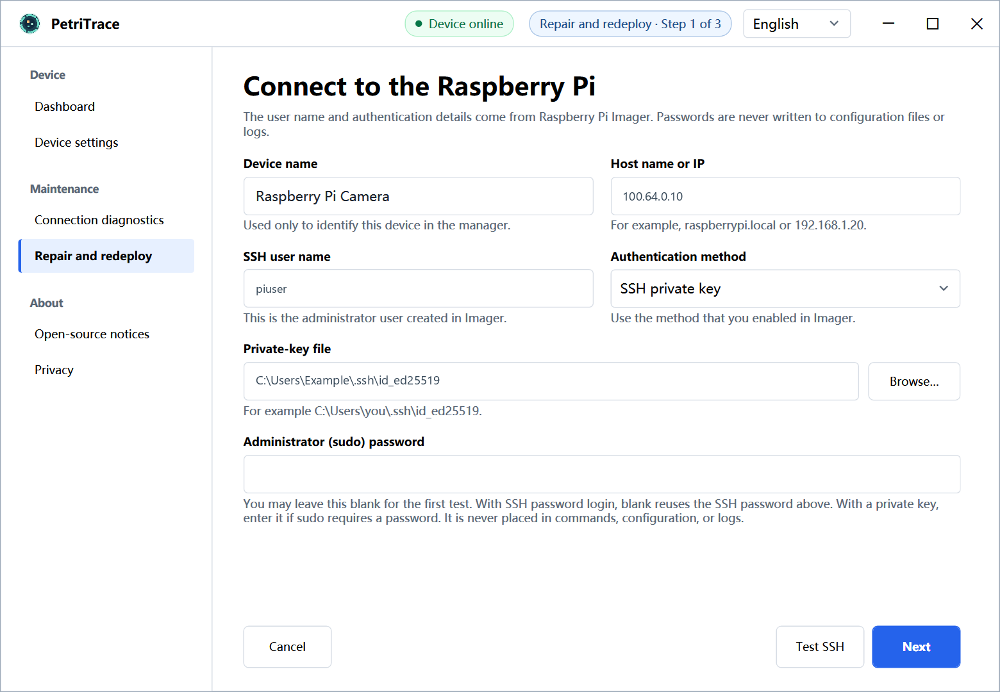

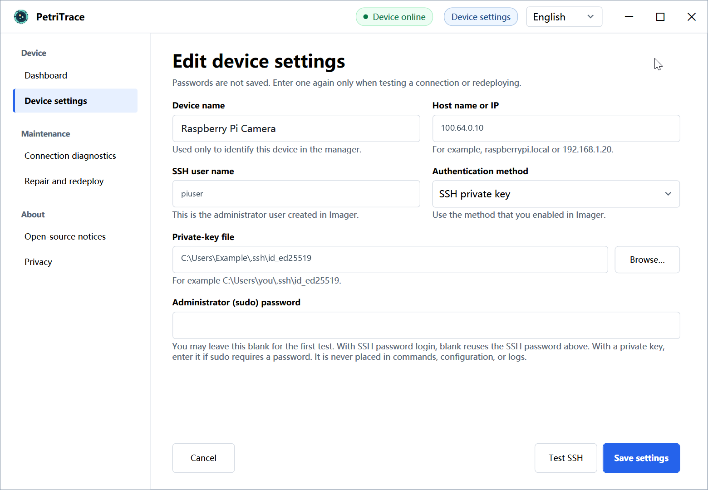

### 6.2 Tailscale远程访问

Tailscale用于从外部网络访问树莓派。首次使用时注册或登录Tailscale账户，在管理器中为树莓派安装Tailscale，并在浏览器中完成设备授权。

在安装模式页面勾选“Configure optional Tailscale remote access”。“Open Tailscale download page”打开下载页面；电脑端安装并登录后，点击“Check again”重新检测。部署过程中，按提示在浏览器中完成树莓派的设备授权。

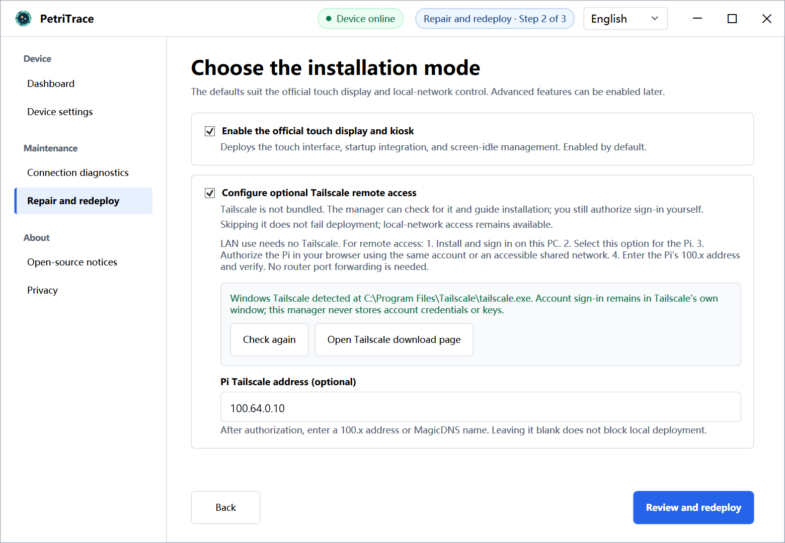

将树莓派的Tailscale地址填入设备配置。用于远程访问的电脑或手机也安装Tailscale，加入同一授权网络。局域网访问可直接使用树莓派的局域网地址。

### 6.3 网页地址

管理器总控台分别显示局域网地址和Tailscale地址，可点击“复制网址”后在另一台设备的浏览器打开。局域网地址适用于同一局域网，Tailscale地址适用于已接入相应网络的设备。点击“打开控制台”可在本机直接进入网页。也可手动输入：

`http://<树莓派地址>:5000`

将尖括号及其中内容整体替换成实际主机名、局域网IP或可达的Tailscale地址。若修改过Web端口，以管理器显示的网址为准。

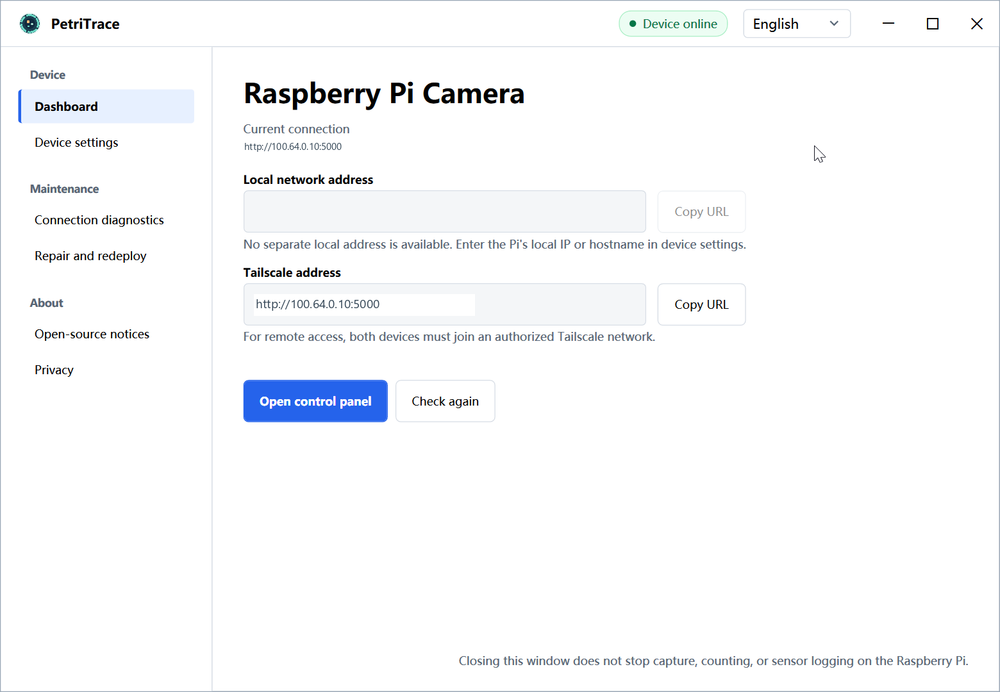

## 7. 首次运行与培养皿放置

先确认页面中相机可用、两路环境数据能够读取、照明可以开关。

打开活动门，将培养皿放在08号上层框板的承托位置，相机从下方向上拍摄，位置关系见图7。试拍一张，检查培养皿是否完整入镜、照明是否均匀。需要调整时，移动培养皿后再试拍。画面两侧会包含部分舱壁，以培养皿完整入镜为准。

检查试拍照片的时间和记录，对照照片检查菌落计数结果，再试做一次导出。完成这些检查后，开始长期记录。

触摸屏用于装置旁操作；电脑和手机可通过浏览器进入同一设备。不同入口操作的是同一台树莓派，开始或停止拍摄会改变设备上的任务状态。

## 8. 拍摄、查看和导出

### 8.1 拍摄控制

在拍摄控制中设置间隔并应用，然后开始定时拍摄。任务在树莓派上持续运行，点击“停止”结束。需要临时照片时使用单次拍摄。

照明设置中的“拍照前亮灯”和“拍照后保持”均填写秒数；亮度填写0到1之间的数值。

“退出时停止Pi Web服务”决定关闭管理器时，是否同时停止树莓派上的网页服务。

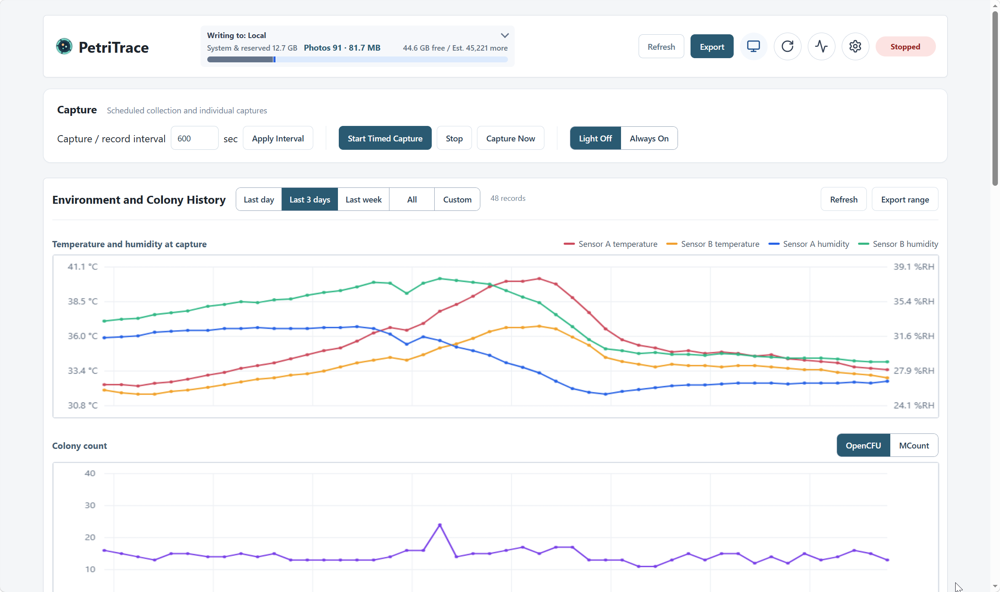

### 8.2 环境与菌落历史

时间范围可选择最近1天、3天、1周、全部或自定义。图表按记录时间显示数据。菌落结果可切换OpenCFU与MCount。

将鼠标移到图表的数据点上，可预览数据。点击图表中的数据点或详细记录列表中的某条记录后，图表和列表会同时突出显示对应项；此时移动鼠标不会切换到其他记录。选中记录时，页面不会自动滚动或切换记录页；对应记录若在其他页，可手动翻页查看。

点击空白处、再次点击该记录或按Esc，可取消固定，恢复悬停预览。

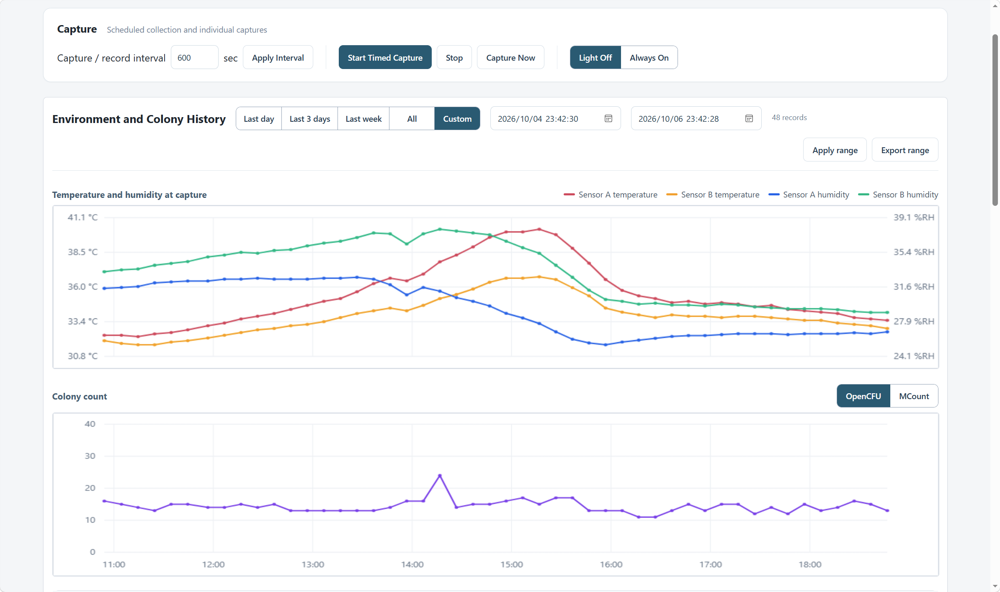

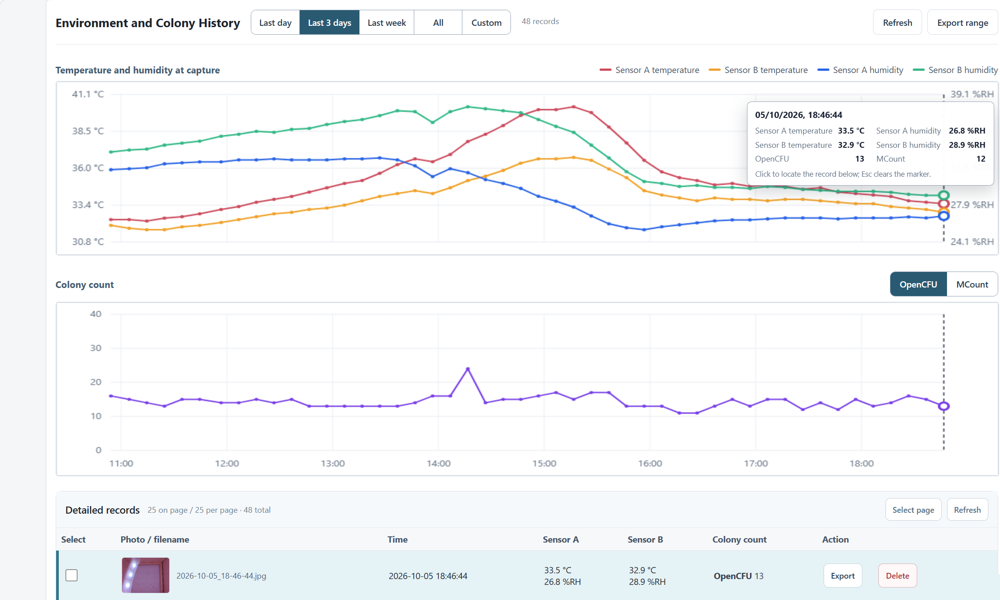

### 8.3 详细记录与照片

本节照片为白纸黑点测试图像，用于演示查看与记录操作。

详细记录按页显示，可在列表中选择每页条数。缩略图用于辨认照片，点击后可查看大图并用左右按钮切换。记录高亮与复选框选择是两个动作：高亮帮助对照图表，勾选用于批量操作。

打开大图后，窗口会先显示整张照片。可以放大查看细节，也可以导出这条记录或下载原图。查看期间背景页面保持原位置。

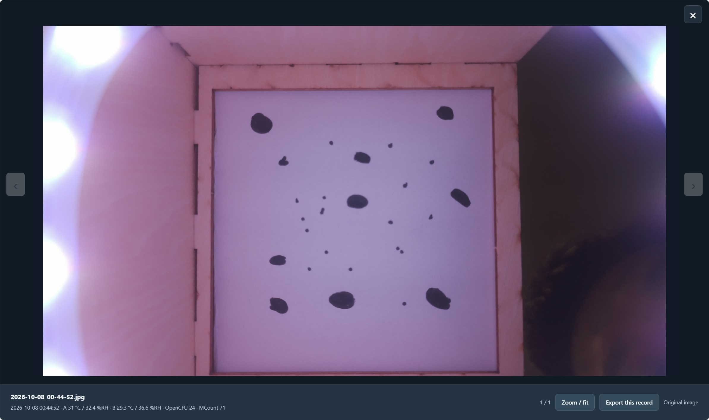

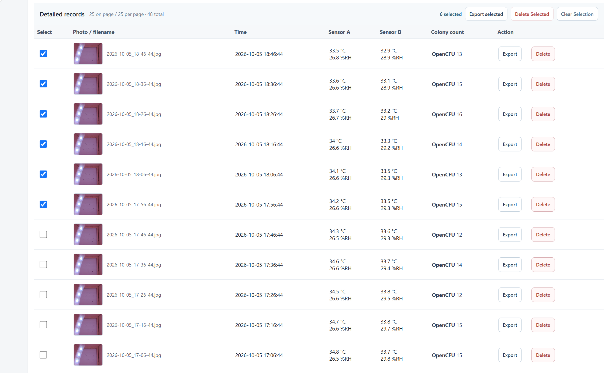

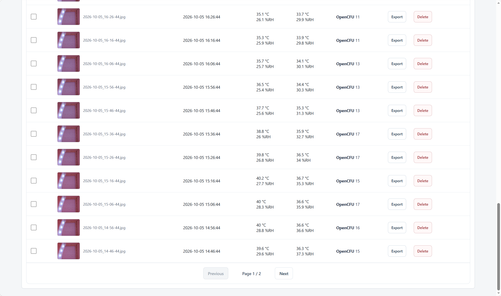

### 8.4 导出

使用网页顶部的“导出”，可导出当前时间范围、自定义范围或全部记录。要导出单条或已勾选的记录，使用“详细记录”中的导出按钮。

可选内容包括原始照片、菌落计数、拍照时的温湿度和独立环境记录。勾选“全选”可选中全部内容。浏览器会记住上次勾选的内容。首次默认不选，换浏览器、换地址或清除网站数据后可能需要重新选择。

从“详细记录”导出时，只导出所选拍摄记录及其对应数据。仅导出一类数据且不含照片时，输出CSV；包含照片或多类内容时，输出ZIP。文件由浏览器下载。

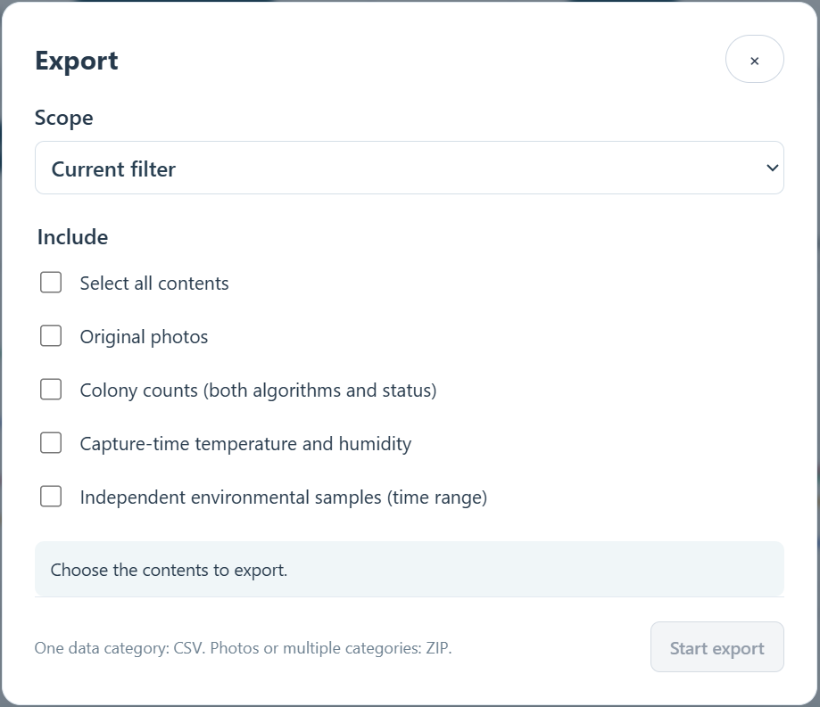

### 8.5 删除

删除单条记录时，点击该行“删除”；批量删除时，勾选记录后点击“删除所选”，在弹窗中确认。照片、菌落计数及拍照时记录的温湿度一起删除。没有伴随拍照、单独记录的温湿度数据仍留在环境历史中。

## 9. 设置、诊断与维护

网页顶部的“Refresh”用于更新状态、图表和记录。要重新加载整个网页，点击显示器图标与诊断图标之间的圆箭头。软件更新后，该圆箭头会提示重新加载；触摸屏则在空闲且没有打开弹窗时自动重新加载。部署完成后，触摸屏浏览器也会重新启动。

管理器负责连接和部署维护；网页设置负责日常参数。管理器首次启动按电脑系统语言选择中文、德语或英语，其他系统语言使用英语。首次部署时，网页沿用管理器的语言。之后可在两端分别切换语言，选择会保存。

网页设置按常规、拍照与照明、外部储存分组，修改后保存。使用外置存储时先查看连接与容量状态，拔出前执行安全弹出。诊断页面显示当前异常和运行信息；屏幕检修工具可用于查看触摸屏实际显示。

顶部出现异常提示时，可选择忽略当前提示。忽略只收起提醒，诊断中的异常及最近记录仍可查看。同一浏览器、同一访问地址会记住忽略状态；出现新的异常记录时仍会提示。

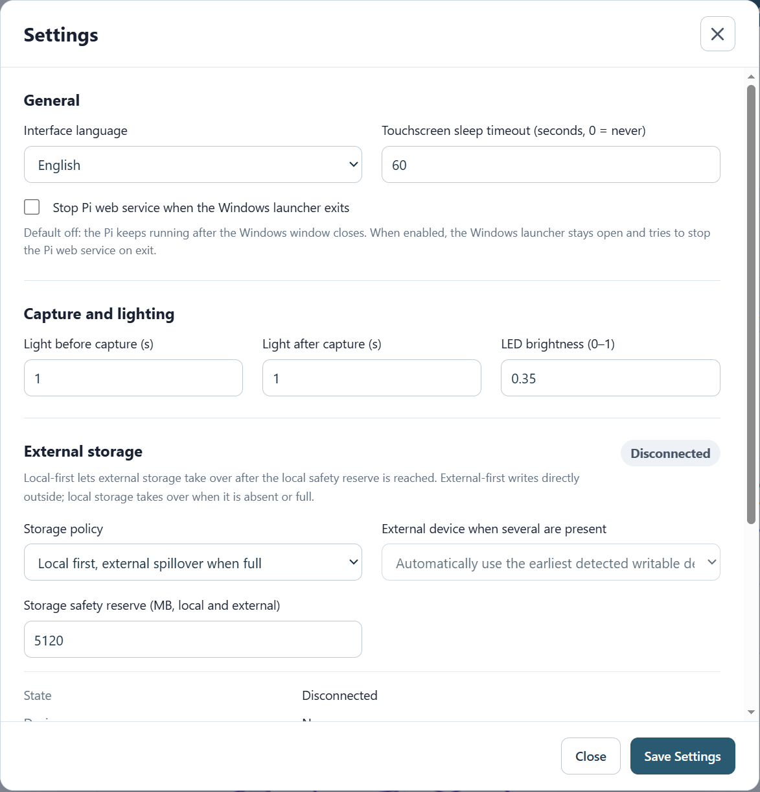

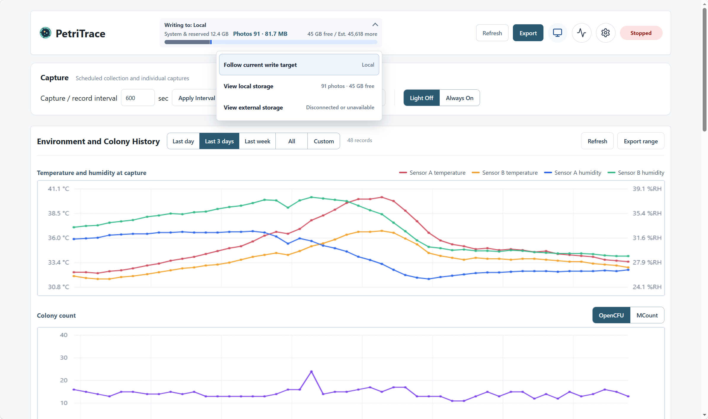

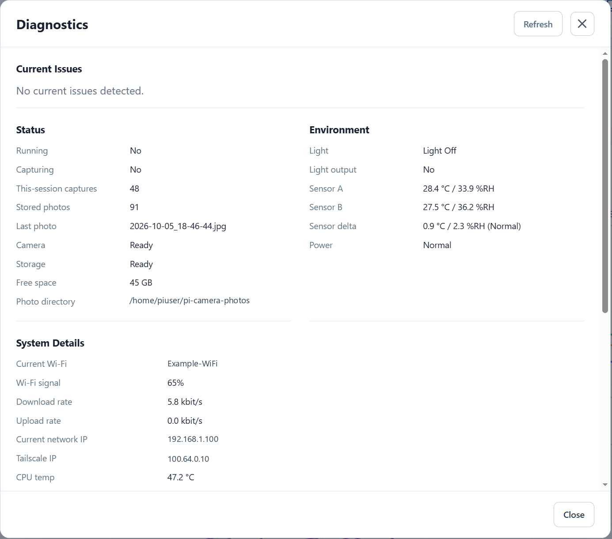

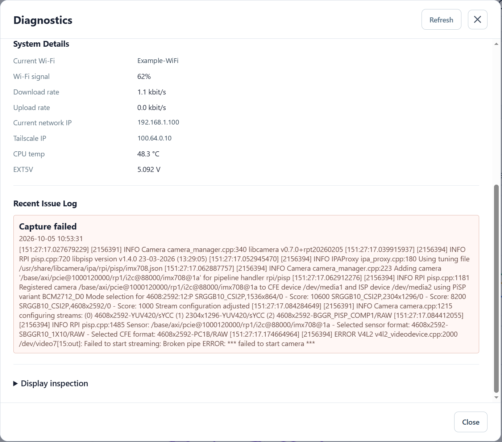

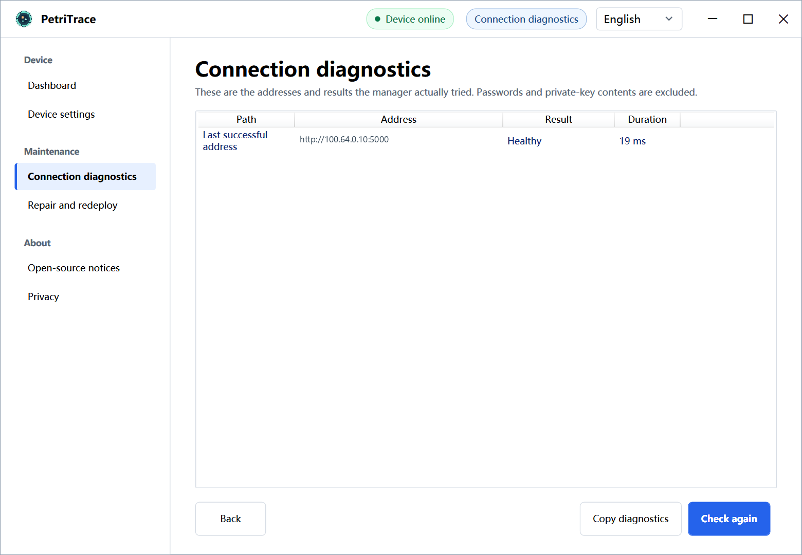

表 8　常见问题与检查方法

| 遇到的情况 | 先检查什么 |
|---|---|
| 管理器找不到树莓派 | 电源、设备地址、SSH、局域网互访；进入连接诊断 |
| 局域网可用，远程打不开 | 检查两端Tailscale是否在线、账户权限是否允许访问，以及是否使用树莓派的Tailscale地址 |
| 网页打不开 | 树莓派的网址、端口与服务状态 |
| 灯带只亮一部分 | 灯带接线、型号及Pico程序是否已更新 |
| 传感器缺数据 | 模块型号、接口针序、I2C连接、Pico固件及USB数据线 |
| 触摸屏未自动进入界面 | Desktop系统、Labwc桌面、桌面自动登录及部署选项 |
| 照片模糊或对焦不稳 | 检查镜头和培养皿、灯带是否遮挡视野、照明是否稳定；试拍后再开始连续记录 |
| 存储不足 | 导出并核对需要保留的记录，再决定删除或调整存储方式 |

修复与重新部署用于维护现有软件。操作前备份照片、数据库和配置。

需要关机时，先正常关闭系统，再断开电源。

遇到无法解决的问题，可在项目的[Issues页面](https://github.com/J-ShuJie/PetriTrace/issues)描述操作步骤、错误提示和软件版本，并附诊断页面的相关信息。提交前遮去密码、私钥和其他私人信息。

## 10. 源码、图纸与许可

项目仓库为[https://github.com/J-ShuJie/PetriTrace](https://github.com/J-ShuJie/PetriTrace)，GitHub账号为J-ShuJie。软件、图纸和手册源文件在仓库中按用途提供；安装包从[Releases](https://github.com/J-ShuJie/PetriTrace/releases)获取。可以修改程序以适应自己的观察任务，也可以采用自己的外壳设计。DWG用于加工，OpenSCAD用于修改模型的形状和尺寸。采用自己的硬件设计时，请根据实际情况调整接线、配置和装配说明。

项目自有内容按MIT许可发布，保留相应版权及许可声明。第三方组件仍遵守其原许可证，具体见仓库的许可文件和第三方明细。

